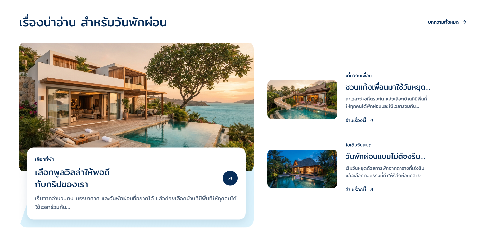

# Article-body-fallback-r2

5 พฤศจิกายน 2026 · ใช้ต้นเนื้อหาเมื่อไม่มีคำโปรย · ภาพใหม่รอตรวจ

ผลตรวจภายหลัง: เจ้าของเลือก `1` ใช้ภาพเมื่อบทความโหลดสำเร็จตามที่แสดง รับเฉพาะ static appearance ของรุ่นนี้พร้อม mock body ตาม [หลักฐานพร้อม hash ภาพ](owner-ready-state-acceptance.json) การตรวจ motion ดำเนินแยกใน Article-motion-r7 ไม่เริ่มฟีเจอร์บทความหรือ Frontend จากคำตอบนี้

คำชี้แจงล่าสุด: เจ้าของระบุว่าทำ Home เผื่อไว้ก่อน เพราะฟีเจอร์บทความยังไม่ได้ออกแบบ รอบนี้จึงใช้ mock body ตรวจหน้าตาได้ ไม่ต้องรอแหล่งบทความจริง กติกาสำหรับตอนมีฟีเจอร์คือใช้ข้อความจากเนื้อหาของบทความเรื่องนั้นมาแสดง ไม่แต่งข้อความแยกแทน ดู [คำชี้แจงเรื่องขั้นงาน](../article-stage-clarification.json) ภาพนี้ยังเป็น fixture และยังรอตรวจ appearance ไม่อ้างว่าได้ดึงข้อมูลจริงแล้ว

เจ้าของดูภาพไม่มีคำโปรยแล้วระบุ “ให้ใช้เนื้อหาแทน” จึงเปลี่ยนกติกาเฉพาะส่วนนี้: ถ้าไม่มีคำโปรย ให้ใช้ข้อความช่วงต้นของเนื้อหาบทความ ทั้งเรื่องเด่นและเรื่องรอง แสดงสูงสุดสองบรรทัด เกินแล้ว ellipsis เก็บเนื้อหาฉบับเต็มไว้ ไม่เขียนสรุปใหม่แทนเนื้อหา ดู [คำสั่งเจ้าของ](owner-instruction.json)

แก้ review root `l5kvNr` เดิมเป็น r2 โดยเพิ่มข้อความกลับเข้าแผง/แถว ไม่ย้ายรูปหรือเปลี่ยนสัดส่วน ภาพ no-excerpt เดิมเก็บใน Article-states-r1 เป็นประวัติและไม่ใช่ภาพของ root ปัจจุบันแล้ว เนื้อหาสามเรื่องเป็น mock body สำหรับตรวจแบบ เก็บข้อความเต็มไว้ใน fixture manifest การตัดข้อความในภาพเป็น static fixture ไม่ใช่ automatic extraction/clamp ที่ทำงานแล้ว

อ่าน geometry ข้อความเด่น 600×52px รอง 360×44px ทั้งสองเรื่อง สอดคล้องกับสองบรรทัดตาม typography เดิม แผงขาวสูงตามเนื้อหา และเรื่องเด่นสูง 552.5px คงระยะด้านล่าง 24px เปิดตรวจ native PNG เต็มที่ 1440px แล้วเห็นข้อความและรูปครบในขอบเขตที่ออกแบบไว้

ยังมี bounds diagnostics จาก Pencil ที่ไม่ตรงกับภาพ export จึงไม่อ้างว่าผ่านทุก structural check ไม่เปลี่ยน Main Home, Footer ที่อนุมัติ, TikTok หรือ variables ไม่แก้ application code/backend

[Manifest](review-manifest.json) · [Native snapshot](editable-snapshot.json) · [Bounds diagnostics](bounds-diagnostics.json)

กติกา required fields และลำดับคัด/เติม latest เดิมคงอยู่ การเลือกใช้เนื้อหาแทนไม่อนุมัติ article appearance/version ทั้งชุด ภาพนี้ยังรอตรวจ จากนั้นจึงตรวจ loading/error ต่อใน R1 Mobile พัก OPEN-001 เปิด ไม่เริ่ม Frontend
