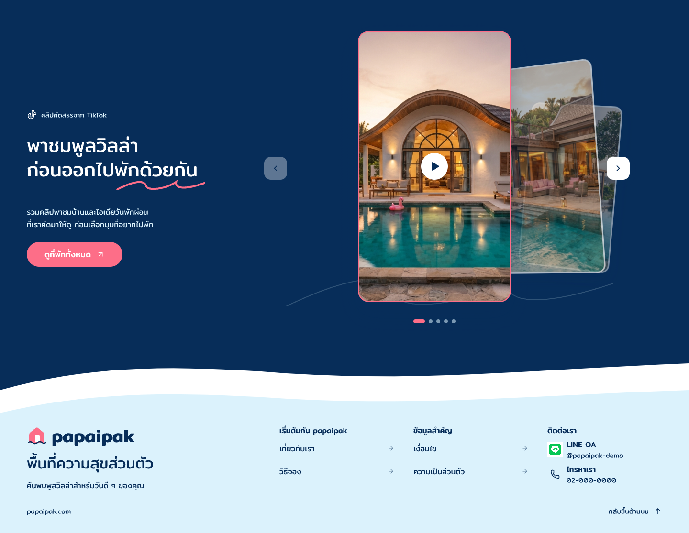

# Article-hidden-r2

5 พฤศจิกายน 2026 · เจ้าของยืนยันให้ซ่อนส่วนบทความที่โหลดไม่ได้และเก็บ log ภายใน

หลังดูภาพบริบทนี้เจ้าของตอบ “โอเค” รับ appearance เฉพาะช่วงที่ไม่มีบทความและต่อจาก TikTok ไป Footer ตาม [หลักฐานพร้อม hash ภาพ](owner-context-acceptance.json) ไม่ถือว่ารับ article/Home version ทั้งชุดหรือมีระบบ log ทำงานแล้ว

เจ้าของต้องการให้ Home ใช้งานต่อได้โดยไม่ผลักภาระแก้ปัญหาไปที่ผู้ใช้ จึงซ่อน section บทความเมื่อโหลดรายการไม่ได้ตามกรณีที่ระบุ ไม่แสดงหัวข้อ ลิงก์ทั้งหมด พื้นที่ section ว่าง แถบผิดพลาด ปุ่มลองใหม่ หรือคำชวนให้รีเฟรช ผู้ใช้รีเฟรชเองได้ตามปกติ ดู [ข้อสรุปและคำพูดเจ้าของ](owner-decision.json)

ข้อกำหนดให้เก็บ log ภายในเพื่อทีมตรวจและปรับปรุงภายหลังเป็น handoff requirement เท่านั้น รอบนี้ยังไม่เลือกบริการ/รายละเอียดระบบ log ไม่เชื่อม backend หรือ analytics และไม่อ้างว่ามี log เกิดขึ้นแล้ว คำตอบนี้ไม่ได้กำหนดนโยบายระบบล่มทั้งเว็บ

ภาพบริบท root `q1Q2w` คัด TikTok first-state `v9qG0` และ Footer ที่อนุมัติ `kengy` มาวางต่อกัน ไม่มี article node และไม่มีช่องว่าง section บทความ รูปคลิปและข้อมูลติดต่อยังเป็น fixture ตามเดิม Main Home และต้นทางทั้งสองส่วนไม่เปลี่ยน ภาพนี้ใช้แสดงผลของการซ่อน ไม่ใช่การอนุมัติ Home ทั้งหน้า

ร่าง retry panel เดิม `f6x4t` ถูกปิดการแสดงและระบุ HISTORY ภาพ/snapshot เดิมยังเก็บใน Article-states-r1 เป็นหลักฐาน ไม่ใช้เป็น active error treatment อีก

Loading skeleton ที่เจ้าของรับยังคงใช้ระหว่างรอ การโหลดล้มเหลวกับโหลดสำเร็จแต่ไม่มีเรื่องเป็นคนละสถานะภายใน แม้ผลบน Home จะซ่อน section เหมือนกัน ไม่บันทึก successful empty result เป็นข้อผิดพลาด

เปิดตรวจ native PNG ขนาด 1440×1115 แล้ว ไม่มีส่วนบทความหรือแถบลองใหม่ระหว่าง TikTok กับ Footer การเชื่อมยังใช้คลื่นเดิมของทั้งสองส่วน ไม่พบพื้นที่บทความค้างในภาพ Bounds diagnostics เก็บแยกตามข้อจำกัด Pencil เดิม ไม่อ้างว่าผ่าน structural หรือ functional checks ทั้งหมด

[Manifest](review-manifest.json) · [Native snapshot](editable-snapshot.json) · [Bounds diagnostics](bounds-diagnostics.json)

ยังต้องรวมตรวจ article/Home version ตามแผน ไม่เริ่มฟีเจอร์บทความ Task อื่น Frontend backend หรือ deploy Mobile พัก OPEN-001 เปิด
