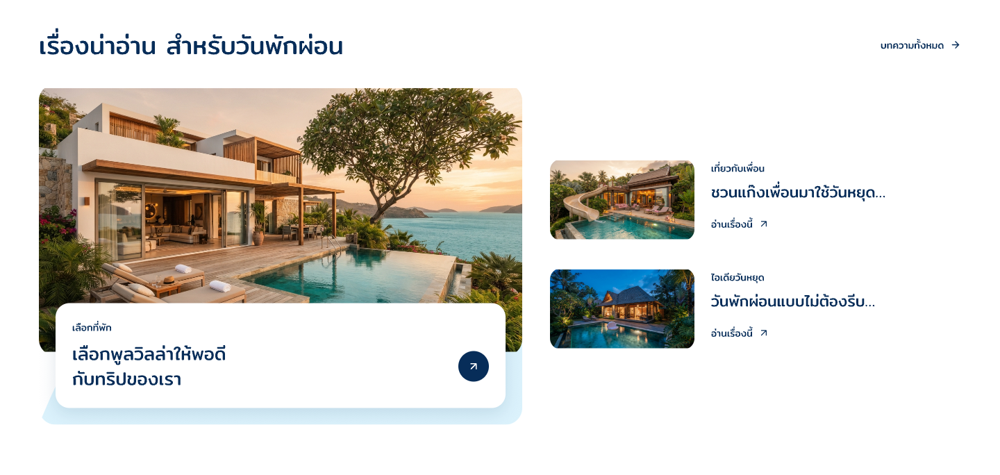

# Article-states-r1

5 พฤศจิกายน 2026 · รับภาพ loading แล้ว · สถานะอื่นและ article version ทั้งชุดยังตรวจต่อ

เจ้าของเลือก `1` ใช้ภาพกำลังโหลดตามที่แสดง รับเฉพาะ static loading appearance / `BvlEu` ที่ Desktop 1440px ดู [หลักฐานพร้อม hash ภาพ](owner-loading-acceptance.json) ไม่รับ animation/timing, error, body fallback หรือ Home ทั้งหน้าจากคำตอบนี้ จุดถัดไปคือภาพ error พร้อมลองใหม่

ข้อสรุปล่าสุดหลังตรวจสาเหตุ: เจ้าของให้ซ่อน section เมื่อโหลดรายการไม่ได้ตามกรณีนี้ และเก็บ log ภายในให้ทีมแก้ภายหลัง ไม่แสดงข้อความ/ปุ่มลองใหม่หรือชวนผู้ใช้รีเฟรช ร่าง error เดิม `f6x4t` ปิดการแสดงและเป็นประวัติแล้ว ดู [Article-hidden-r2](../article-hidden-r2/README.md) ส่วน loading ที่รับไม่เปลี่ยน

ผลตรวจภาพ no-excerpt: เจ้าของระบุ “ให้ใช้เนื้อหาแทน” จึงเปลี่ยน root `l5kvNr` เป็น [Article-body-fallback-r2](../article-body-fallback-r2/README.md) แล้ว ภาพ no-excerpt และ snapshot ในโฟลเดอร์นี้เป็นประวัติก่อนแก้ ไม่ใช้การยุบพื้นที่เมื่อมีเนื้อหาให้ดึงมาแทนอีก ส่วน default/error ยังรอตรวจ และ loading รับเฉพาะภาพนิ่งแล้ว

เจ้าของอนุมัติ Footer-contact-column-r4 แล้ว จึงดำเนิน R1 ของ [แผนตรวจ Home](../home-desktop-closeout-plan.md) ต่อภายใน DSD-001 ชุดนี้รวมกติกาข้อความ/ปกที่ยืนยันไว้กับคำตอบ Q3–Q5 เป็นภาพสำหรับตรวจ ไม่ใช่ runtime หรือ Home ทั้งหน้าที่รวมแล้ว

| State | Native root | ภาพ | สถานะ |
| --- | --- | --- | --- |
| ปกติสามเรื่อง | KCbCH | [default](KCbCH.png) | เตรียมเป็นฐานเทียบ ยังไม่รับรุ่นรวม |
| ไม่มีคำโปรยทั้งสามเรื่อง | l5kvNr | [no excerpt](l5kvNr.png) | ภาพแรกที่นำมาตรวจในรอบนี้ |
| กำลังโหลดรายการ | BvlEu | [loading](BvlEu.png) | เจ้าของเลือก 1 รับภาพนิ่งแล้ว |
| ร่างผิดพลาดพร้อมลองใหม่เดิม | f6x4t | [ประวัติ error](f6x4t.png) | ถูกแทนด้วยการซ่อน section; native root ปิดการแสดงแล้ว |

## ภาพแรก: ไม่มีคำโปรย

คัดจาก section `W0z7U` ใน Article-excerpt-r1 แล้วตัดคำโปรยและช่องว่างที่เกี่ยวข้องออกตาม Q3 เรื่องเด่นลดความสูง 36px ตามคำโปรย 26px และช่องไฟ 10px ที่เอาออก แผงขาวสูงตามเนื้อหา รูปปกและตำแหน่งซ้อนภาพคงเดิม เรื่องรองเหลือหมวด ชื่อ และอ่านเรื่องนี้ ไม่จองพื้นที่คำโปรยว่าง

เก็บชื่อเรื่องเด่นสูงสุดสองบรรทัด รองหนึ่งบรรทัด และคำโปรยเมื่อมีสูงสุดสองบรรทัด ชื่อรองในภาพใหม่ใช้ข้อความ ellipsis จำลองให้เห็นเพียงบรรทัดเดียว เก็บชื่อเต็มไว้ใน metadata ไม่ถือว่าได้ทำ automatic clamp หรือ accessibility runtime แล้ว

## Loading และ error

Skeleton รักษาพื้นที่องค์ประกอบหลักตาม default: รูปเด่น 696×391.5, แผงซ้อน และเรื่องรองรูป 208×117 ใช้สีอ่อนจาก visual system มีเพียงส่วนบทความอยู่ใน loading ไม่บัง Home ทั้งหน้า ภาพเป็น static/reduced-motion reference ยังไม่เลือกจังหวะ pulse หรือทำ animation จริง

Error/retry panel ที่เคยเสนอเป็นประวัติ Q5 เดิมเท่านั้น ข้อสรุปปัจจุบันให้ซ่อน section และเก็บข้อผิดพลาดภายใน ไม่มี recovery control สำหรับผู้ใช้ ดู Article-hidden-r2

กรณีมีเรื่องพร้อมหนึ่ง/สองเรื่องใช้ภาพที่รับไว้ใน [Article-count-r1](../article-count-r1/README.md) หลังใช้กติกาเติม latest ของ Q7 แล้ว หากทั้งคลังไม่มีเรื่องพร้อมให้ซ่อน section ตาม Q2 ภาพการเชื่อม section ในกรณีศูนย์เรื่องยังต้องตรวจตอนรวม Home ไม่สร้าง empty message แทน

## หลักฐานและข้อจำกัด

เปิดตรวจ PNG ทั้งสี่ที่ 1440px แล้ว เนื้อหาและรูปทรงสำคัญเห็นครบในภาพ ตรวจแบบจากภาพจริงโดยไม่ย่อให้เป็น viewport ใหม่ `Get` ยังมี bounds diagnostics บางจุดต่างจากภาพ native export จึงเก็บผลไว้และไม่อ้างว่าผ่านทุก structural bounds ตรวจ geometry อ่านกลับและ PNG แยกกัน

คง source default/ภาพ count เดิม Main Home, Footer ที่อนุมัติ, TikTok, Header และ variables ไม่เปลี่ยน ไม่สร้างหรือแก้ application code

[Manifest](review-manifest.json) · [Native snapshots](editable-snapshots.json) · [Geometry](geometry.json) · [Bounds diagnostics](bounds-diagnostics.json)

ยังต้องตรวจภาพแต่ละ state, motion/focus ที่สอดคล้องกับบทความรุ่นรวม และ safe-area study ที่มีข้อความบนปก ก่อนรับ article version ทั้งชุดและรวม Home ตามแผน ไม่มี functional/Frontend acceptance Mobile พัก OPEN-001 เปิด
