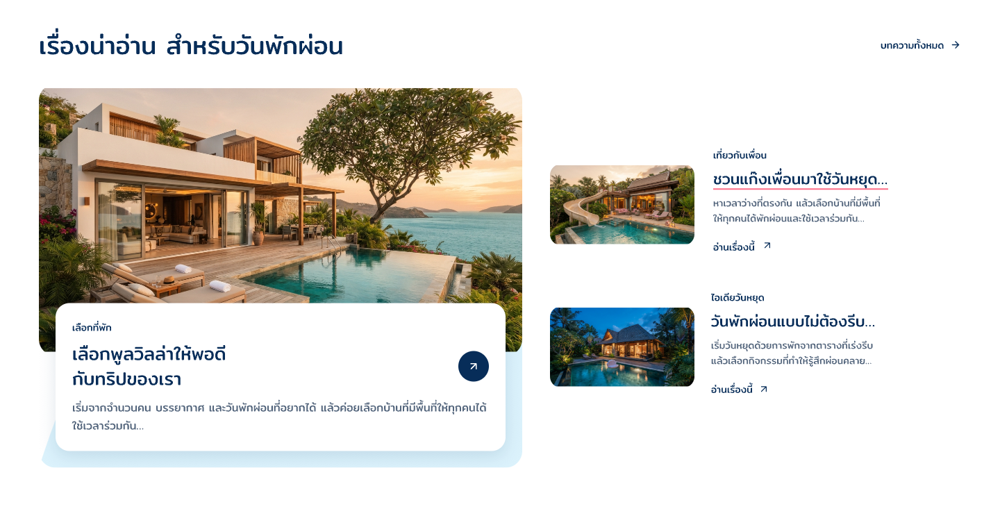

# Article-supporting-motion-r8

5 พฤศจิกายน 2026 · ร่าง interaction เรื่องรอง · รอตรวจ

ผลตรวจภายหลัง: เจ้าของเลือก `1` ใช้ตามตัวอย่าง รับ supporting hover ที่แสดงใน r8 ตาม [หลักฐานพร้อม hash](owner-supporting-motion-acceptance.json) จากนั้นแยกภาพ focus ให้ตรวจใน Article-focus-r1 ไม่ยกการรับ hover เป็นการรับ article/Home ทั้งชุด

หลังเจ้าของเลือก `1` รับ [featured motion r7](../article-motion-r7/owner-featured-motion-acceptance.json) จึงเตรียมเรื่องรองต่อใน R1 โดยคง ready-state layout และข้อความที่รับแล้ว

## ข้อเสนอ

- รูปเรื่องรองคงขนาด 208×117 และแสดงภาพแบบเดิม ไม่ซูมภาพด้านใน ไม่เอียงหรือยกกรอบรูป
- เมื่อ hover ข้อความเลื่อนขวา 3px มีเส้นใต้ชื่อสีชมพู และลูกศรอ่านเรื่องเลื่อนขวา 2px/ขึ้น 2px
- ใช้ระยะเปลี่ยนสถานะ 336ms และ easing เดียวกับตัวอย่างเรื่องเด่นที่รับ เป็นข้อเสนอเฉพาะ interaction นี้ ไม่ได้ประกาศ shared token ใหม่
- Reduced motion คงตำแหน่งข้อความและลูกศร แสดง feedback เส้นใต้แบบทันทีแทนการเคลื่อนที่
- ทั้งเรื่องยังเป็นลิงก์เดียว Focus มีเส้น Navy 2px รอบเรื่อง ไม่มี Tab stop แยกให้รูป ลูกศร หรืออ่านเรื่องนี้

Native hover endpoint `ZuiOX` คัดจาก ready root `l5kvNr` และปรับเฉพาะเรื่องรองแถวแรกเพื่อเทียบกับแถวสองที่ยังเป็นปกติ ต้นฉบับและ featured motion ที่รับแล้วไม่เปลี่ยน รูป/เนื้อหาเป็น fixture เดิม ไม่เริ่มฟีเจอร์บทความจริง

ตัวอย่างเคลื่อนไหวในแชตแสดงเรื่องรองหนึ่งเรื่อง มีปุ่มจำลอง hover/ลดการเคลื่อนไหว ลิงก์ไม่พาออกไปไหนและไม่เชื่อม backend การจัดให้พอดีกับจอ preview ไม่ใช่ Mobile acceptance

## การตรวจ

เปิด native PNG ล่าสุดที่ 1440px แล้ว รูปคงขนาดเดิม เส้นใต้และลูกศรเห็นครบ ไม่พบการทับกับแถวถัดไปในภาพ ตรวจ syntax script ด้วย `node --check` และตรวจ inline assets/ขนาดจาก source แล้ว ยังไม่ได้ทดสอบ interaction ใน browser จริงหรือยืนยัน font loading/compatibility ไม่อ้างภาพนิ่งเป็นผล runtime และยังเก็บ bounds diagnostics ตามข้อจำกัด Pencil เดิม

[Manifest](review-manifest.json) · [Native snapshot](editable-snapshot.json) · [Bounds diagnostics](bounds-diagnostics.json)

ยังรอตรวจ supporting motion, focus appearance และ safe-area study ก่อนตรวจ article version รวมตามแผน Main Home, Footer, TikTok, loading และ hidden context ที่รับแล้วคงเดิม ไม่เริ่ม application code/backend/deploy Mobile พัก OPEN-001 เปิด
