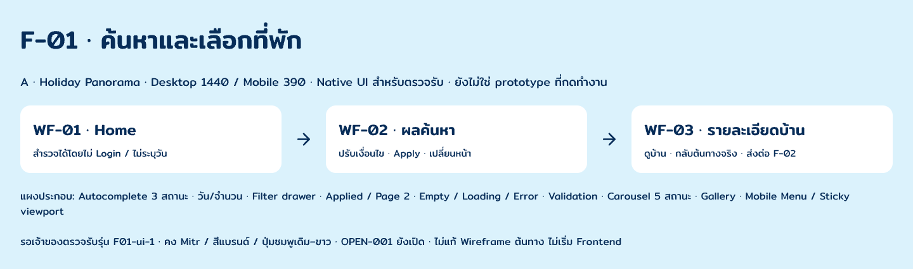

# F-01 · A UI · F01-ui-1

รุ่นปัจจุบัน: [F01-ui-3](../f01-ui-3/README.md) ใช้ชื่อ papaipak และชุดไอคอนที่เจ้าของเลือก เอกสารด้านล่างเก็บลำดับงาน ui-1 เดิม

รุ่นล่าสุดสำหรับตรวจการปรับ Header ทั้ง F-01 คือ [F01-ui-2](../f01-ui-2/README.md) ตามคำขอ “โอเคเอาไปปรับให้ครบ” หลังอนุมัติ Home Desktop Header-r11 เอกสารและภาพด้านล่างเป็นหลักฐานชุด F01-ui-1 ก่อนปรับทั่วทั้ง flow

3 พฤศจิกายน 2026 (Asia/Bangkok) · **Static native UI / รอเจ้าของตรวจรับ**

ระหว่างตรวจทีละหน้า เจ้าของขอ “ปรับ header” ของ Home Desktop มี [ข้อเสนอ Header-r2 ก่อน–หลัง](header-r2/README.md) แยกให้เลือก ยังไม่เปลี่ยน Header ของชุดหลักหรือมือถือ

Feedback ล่าสุดชอบฝั่งซ้ายของแบบ 2 แต่ฝั่งขวายังไม่ตรง จึงมี [Header-r3 · ปรับเฉพาะฝั่งขวา](header-r3/README.md) เป็นข้อเสนอปัจจุบัน รอตรวจแยกโดยยังคงรุ่นก่อนทั้งหมด

เจ้าของเลือกปรับหน้าตาฝั่งขวาต่อ จึงมี [Header-r4 · สามตัวเลือกหน้าตา](header-r4/README.md) สำหรับเลือกจากภาพ คงตำแหน่ง r3 และฝั่งซ้าย r2 ตามเดิม

Feedback ล่าสุดให้ศึกษาเว็บจริงเพราะข้อความเยอะ จึงมี [Header-r5 · เมนูหลักและ icon utilities](header-r5/README.md) พร้อมหลักฐาน public Header และสถานะภาษา/ติดต่อ เป็นข้อเสนอปัจจุบันที่ยังรอตรวจ

เจ้าของระบุว่าแบบ compact พอดีแล้วและขอออกแบบให้ดีขึ้น จึงมี [Header-r6 · เก็บรายละเอียด](header-r6/README.md) เป็นข้อเสนอปัจจุบัน คงจำนวนข้อความ/ไอคอนของ r5 และยังรออนุมัติเวอร์ชัน

เจ้าของย้ำให้ดูสถานะก่อน Login จึงมี [Guest Header-r7](header-r7-guest/README.md) เป็นข้อเสนอปัจจุบัน ใช้ปุ่มข้อความเข้าสู่ระบบแทนไอคอนบัญชีเพื่อให้สถานะ Guest ชัด

เจ้าของถามว่าแบบ A ครบ F-01 ตาม `papaipak-wireframe.pen` หรือยัง หลังได้รับรายการส่วนที่ขาด เจ้าของตอบ “ทำให้หรบ” ซึ่งตามบริบทเป็นคำสั่งให้ทำให้ครบ จึงขยายชิ้นงาน Pencil รอบนี้เฉพาะ F-01: Home → Results → Detail และ supporting states ของ flow นี้ โดยคง Direction A, palette, Mitr, selected layouts และกฎ UX เดิม ไม่เปลี่ยน Task อื่นเป็น started/completed และไม่อนุมัติ Frontend

## เปิดใน Pencil

[ไฟล์ native ที่ใช้งานจริง](C:/Users/chaym/.pencil/documents/5738e270-25e4-4bf2-9d22-fad4c0b58275/papaipak-ui.pen) · เริ่มที่บอร์ด **F01 · START HERE · A UI review-1** (`w9QeyO`)

ไฟล์ native อยู่ใน documents ของ Pencil มี [layer snapshot](editable-snapshot.json) และ [assets](images/) สำรองใน repository ไม่อ้างว่า Save As เข้า repository หรือทดสอบเปิดใหม่หลัง restart แล้ว Snapshot เป็น JSON สำหรับอ้างอิง/สร้างคืนผ่าน MCP ไม่ใช่ไฟล์ .pen ที่เปลี่ยนนามสกุลแล้วเปิดได้

## หน้าหลัก

| หน้า | Desktop 1440 | Mobile 390 |
|---|---|---|
| Home · WF-01 | [ภาพ](A1ks07.png) | [ภาพ](PiA4h.png) |
| ผลค้นหา · WF-02 | [ภาพ](osaIa.png) | [ภาพ](L8ev6.png) |
| รายละเอียดบ้าน · WF-03 | [ภาพ](qcEOf.png) | [ภาพ](S3VaWy.png) |

## สถานะและทางแยก

| ส่วน | Desktop | Mobile |
|---|---|---|
| Autocomplete: เปิด / เลือกแล้ว / ไม่พบคำแนะนำ | [ภาพ](Oyv0v.png) | [ภาพ](GjoEH.png) |
| Calendar: ยังไม่เลือก / เลือกช่วงแล้ว / คนรวมและ pets | [ภาพ](LoLN7.png) | [ภาพ](E9JumJ.png) |
| ตัวกรอง: draft / ปิดก่อน Apply | [ภาพ](JGYFJ.png) | [Drawer 390×844](NhfIy.png) |
| Results หลัง Apply · 6 fixture records | [ภาพ](NmzZ4.png) | [ภาพ](YQRxl.png) |
| Results หน้า 2 · บ้านตัวอย่าง 09–16 | [ภาพ](HpR7z.png) | [ภาพ](P62IV.png) |
| Loading / ไม่มีผล / โหลดผิดพลาด | [ภาพ](Qu46v.png) | [ภาพ](O5lUa1.png) |
| เลือกวันเข้าแต่ยังไม่มีวันออก · inline error / recovery | [ภาพ](vnCNA.png) | [ภาพ](Rg5AF.png) |
| Carousel: แรก / กลาง / สุดท้าย / รูปเดียว / รูปเสีย | [ภาพ](g9sYI.png) | [ภาพ](dbMM6.png) |
| Gallery viewer | [1440×900](TKJ7Z.png) | [390×844](avf6v.png) |
| เมนูเปิด | ใช้ Header บนหน้าหลัก | [390×844](E3Tu4.png) |
| Detail sticky booking bar | ใช้ booking panel | [Viewport 390×844](yL7bS.png) |
| กลับ Home / Results หน้า 2 / ยกเลิก filter draft | [แผงบริบท](uBBn2.png) | ใช้กติกาเดียวกัน |

บอร์ดสถานะเป็น review groups มี UI panels หลายกรณี ไม่ใช่ routes เพิ่ม 28 หน้า ดูรายละเอียด node IDs, จำนวนเลเยอร์และภาพใน [review manifest](review-manifest.json)

## กฎที่รักษา

- สำรวจและค้นหาได้โดยไม่ Login และไม่ระบุวัน/จำนวนคน แต่ถ้าเริ่มเลือกวันแล้วต้องครบช่วง หรือให้ล้างวันกลับเป็นไม่ระบุ
- Suggested Search Chips แยกจาก Applied filter chips; Reset แก้ draft, ปิดก่อน Apply ทิ้ง draft, Apply จึงใช้ค่าใหม่
- Desktop มี sidebar; Mobile มี drawer และ actions สำหรับล้าง/ใช้ตัวกรอง แสดงช่วงราคาสองค่าและห้องนอนต่ำสุด–สูงสุดเป็น −/+ แยกกัน
- เลือกสถานที่จาก suggestion กลับ origin พร้อมค่า ไม่มีขั้น Apply สถานที่เพิ่ม ส่วนปุ่มค้นหาปรากฏในตัวอย่างสถานะ origin หลังเลือกแล้ว
- จำนวนคนรวมค่าเดียวและ pets แยกกัน ไม่แยกผู้ใหญ่/เด็ก ไม่ถือว่า fixture 12 คนเป็น capacity contract
- Carousel เปลี่ยนรูปแยกจากการเปิด Detail, ไม่มี autoplay/loop, next ยังแสดงแต่ disabled เมื่อสุดท้าย, รูปเดียวไม่มี arrows/dots, รูปเสียมีข้อความและไม่มี Retry
- Detail กลับต้นทางจริงพร้อมบริบทที่ยังใช้ได้ หน้า Home เปิด Detail ตรงได้ ไม่บังคับผ่าน Results
- Favorite ของ Guest ส่งต่อ Auth/F-06 ไม่มี temporary Guest favorites; เลือกจองส่งต่อ F-02 ชุดนี้ไม่สร้าง Login/Checkout หรือ flow ถัดไป
- Navigation และ Footer ใช้ inventory ของ Wireframe รวมข้อความแสดงผลข้างโลโก้ ภาษา LINE OA และโทร โดยไม่เติมบัญชีธนาคาร เบอร์ หรือ URL จริง

## Fixtures และภาพ

ใช้ [fixtures.json](fixtures.json) เป็นข้อมูลสมมติสำหรับตรวจ UI: 24 records, หน้าละ 8, หน้า 2 แสดง 09–16 และตัวอย่างตัวกรองรับสัตว์เลี้ยงตรงกับหก records แรก ไม่ใช่ catalog, policy, availability, quote หรือ query contract

ภาพ A ใช้ asset เดิมจาก [pencil-A-1 asset record](../pencil-A-1/asset-record.md) ไม่มีการสร้างรูปใหม่ในรอบ F-01 รูป gallery หลายช่องเป็น crop ของภาพสมมติเดียวกัน ไม่ใช่หลักฐานว่ามีภาพถ่ายบ้านจริงห้าภาพ เก็บ SHA-256 ของ assets ที่ใช้ไว้ใน manifest

## เกณฑ์ตรวจรับและสถานะ

| เกณฑ์ | หลักฐาน / สถานะ |
|---|---|
| ครอบคลุม UI ของ F-01 ทั้งทางหลักและทางแยกที่ระบุ | 15 coverage rows / 28 exported review groups |
| ข้อความ ไอคอน fields, card copy และ state layouts แก้ได้ | 3,130 native nodes ในกลุ่ม F01; ไม่ใช่ภาพทั้งหน้าแทน UI |
| สีแบรนด์และ Mitr คงเดิม | อ่านกลับ font.primary=Mitr; ไม่มีฟอนต์เสริม |
| ข้อมูลข้ามหน้าสอดคล้องกัน | ตรวจจำนวนการ์ด รายการหน้า 2 และ fixture filters แล้ว |
| รักษารุ่นเดิม | เทียบข้อมูลจาก MCP: A/B roots เดิมทั้งห้าไม่เปลี่ยน และ SHA-256 ของ review-2 ทั้งหกภาพตรงเดิม |
| การทำงานของปุ่มและ transitions จริง | **ยังไม่มี functional prototype / Frontend** |
| OPEN-001 | คงชมพู #FD6E88 / ขาวตามเจ้าของเลือก; ไม่รับรอง AA; ยังเปิด |
| Owner review | **F01-ui-1 ยังไม่อนุมัติ** |

[QA และข้อจำกัด](qa.md) · [Wireframe ต้นทาง](../../uxd-002/papaipak-wireframe.pen) · [F-01 flow contract](../../uxd-002/review-5/flow-groups/README.md)

UXD-002 review-5 ยังรอตรวจรับ ไม่ได้แก้หรือถือว่าอนุมัติจากการใช้เป็น reference ในรอบนี้ ร่าง foundation-1 ยังต้อง alignment กับ A การทำชุด UI F-01 ไม่ทำให้ DSD-001 ทั้ง Task เสร็จ และยังต้องอนุมัติแบบ/เวอร์ชันก่อนเริ่ม Frontend แยก
