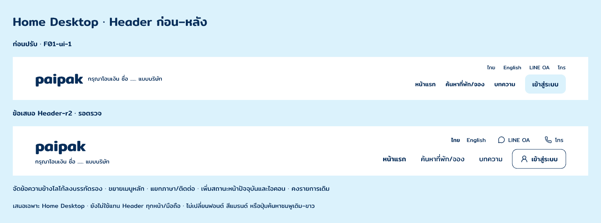

# Home Desktop · Header-r2

3 พฤศจิกายน 2026 · **ข้อเสนอเฉพาะ Header / รอเจ้าของเลือก**

เจ้าของเลือกตรวจทีละหน้า จากนั้นเลือกปรับบางจุดและระบุ “ปรับ header” จึงเสนอ Header ใหม่ของ Home Desktop ภายใน F01-ui-1 โดยสร้าง candidate แยกจากหน้าปัจจุบัน ยังไม่ใช้แทน Header ทุกหน้า/มือถือ

[ดู Home ทั้งหน้ากับ Header ใหม่](TBasB.png) · [Header ใหม่](lOIQO.png) · [Header เดิม](QUgsg.png) · [ไฟล์ Pencil](C:/Users/chaym/.pencil/documents/5738e270-25e4-4bf2-9d22-fad4c0b58275/papaipak-ui.pen)

## สิ่งที่เสนอเปลี่ยน

- แยกข้อความประกอบไปอยู่ใต้ wordmark แทนการอยู่ในบรรทัดเดียวกัน ชื่อและข้อความตาม Wireframe ยังอยู่ครบ
- เพิ่มเมนูหลักจาก 15 เป็น 17px และพื้นที่เมนู 48px ทำให้แยกจาก utility 14px ได้ชัดขึ้น
- จัดภาษาและ LINE OA/โทรไว้แถวบน เพิ่มไอคอนเพื่อแยกช่องทาง โดยไม่เติม URL หรือเบอร์จริง
- แสดงหน้าแรก/ภาษาไทยที่กำลังเลือกด้วย Navy underline และน้ำหนักข้อความ ไม่เพิ่มคู่สี Pink/White สำหรับ state ใหม่
- ปุ่มเข้าสู่ระบบเป็นขอบ Navy พร้อมไอคอน ขนาด 48px ส่วนปุ่มค้นหาชมพูเดิม/ข้อความขาวใน Hero คงเดิม
- Header สูง 124px จากเดิม 108px พื้นขาว Mitr และ palette เดิม

## ขอบเขตและหลักฐาน

Candidate Home คือ `TBasB`, Header คือ `lOIQO`, บอร์ดก่อน–หลังคือ `zo9bx` Native layers แก้ไขได้ ไม่ใช่การวางภาพ Header สำเร็จรูป

[Layer snapshot](layer-snapshot.json) เก็บสองรากใหม่พร้อม variables; รูปทั้งหมดใช้ [assets ของชุด F01-ui-1 เดิม](../images/) และ URI ของไฟล์ native เดิม ไม่สร้างภาพหรือโลโก้ใหม่ [ผลตรวจ](verification.json) แยกการเทียบรุ่นเดิมและการเปลี่ยนเฉพาะ Header

ตรวจ screenshot ของ Header, บอร์ดเทียบและ Home ทั้งหน้าแล้ว เมนู/utility อยู่ในกรอบและ Hero ต่อเนื่องกับ Header Native bounds บางค่ามี offset ไม่สม่ำเสมอ และ warning ID ชั่วคราวหนึ่งตัวไม่พบเมื่ออ่านซ้ำ จึงไม่รับรอง clipping ทุก node จาก diagnostics เพียงอย่างเดียว

ยังไม่อนุมัติ Header-r2 ไม่อนุมัติ Home Desktop/Mobile ทั้งหน้า หรือ F01-ui-1 ทั้งชุด ไม่มีการเชื่อม interaction / Frontend; OPEN-001 ยังเปิดตามเดิม
