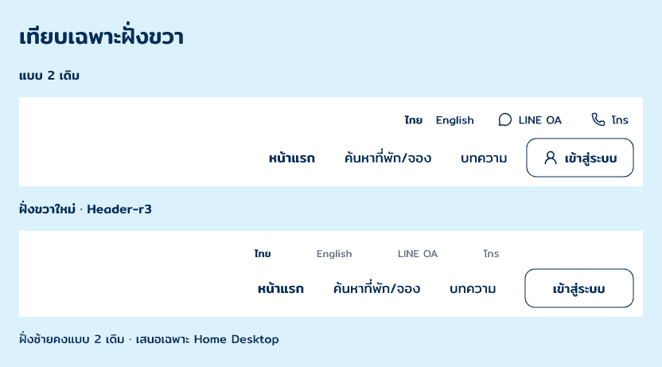

# Home Desktop · Header-r3 · right refinement

3 พฤศจิกายน 2026 · **ข้อเสนอฝั่งขวา / รอเจ้าของตรวจ**

เจ้าของระบุ “ชอบแบบ 2 แต่ทางด้านขวายังไม่โอเค” จึงคงฝั่งซ้ายของ Header-r2 และเสนอการจัดฝั่งขวาใหม่ ไม่อ่านคำว่า “ชอบ” เป็นการอนุมัติ Header หรือ Home ทั้งหน้า

[เทียบ Header เต็ม](nRLa1.png) · [ดู Home ทั้งหน้ากับข้อเสนอ](hv4gv.png) · [Pencil](C:/Users/chaym/.pencil/documents/5738e270-25e4-4bf2-9d22-fad4c0b58275/papaipak-ui.pen)

- รวมเมนูหลักไว้ในคอลัมน์เดียว ใช้ Mitr 17px และคง inventory หน้าแรก / ค้นหาที่พัก/จอง / บทความ
- วางไทย English LINE OA โทรเป็นแถวรอง 13px บนกรอบเดียวกับเมนู ใช้ Navy/สี muted ที่มีอยู่ ไม่เติมช่องทางจริง
- แยกเข้าสู่ระบบเป็น action 136×48px ที่ปลายขวาและจัดให้ตรงแถวเมนูหลัก ตัดไอคอนและเส้นใต้ของรุ่นก่อนเพื่อลดสิ่งแย่งสายตา
- Header ยังคงสูง 124px ฝั่งซ้ายและส่วนอื่นของ Home ตาม Header-r2 ปุ่มค้นหาชมพูเดิม/ข้อความขาวและ Mitr คงเดิม

Candidate Home `hv4gv`, Header `aDHHG`, บอร์ด Header เต็ม `nRLa1`, บอร์ดขยายขวา `GUaKM` เป็น native layers แก้ไขได้ ดู [snapshot](layer-snapshot.json) และ [ผลเทียบ](verification.json) Assets ใช้ [ชุดเดิม](../images/) กับ URI ของไฟล์ native

แก้ warning fit/fill ที่คอลัมน์ utility โดยตั้งความกว้าง 308px ตามเมนูที่วัดได้ แล้วตรวจ screenshot และ export ใหม่ ไม่มีการใช้ image-generation หรือสร้างโลโก้ใหม่ในรอบนี้

ยังไม่ใช้แทน Header หลัก/มือถือหรือหน้าอื่น ไม่มีการเชื่อม interactions หรือ Frontend และ OPEN-001 ยังเปิด
