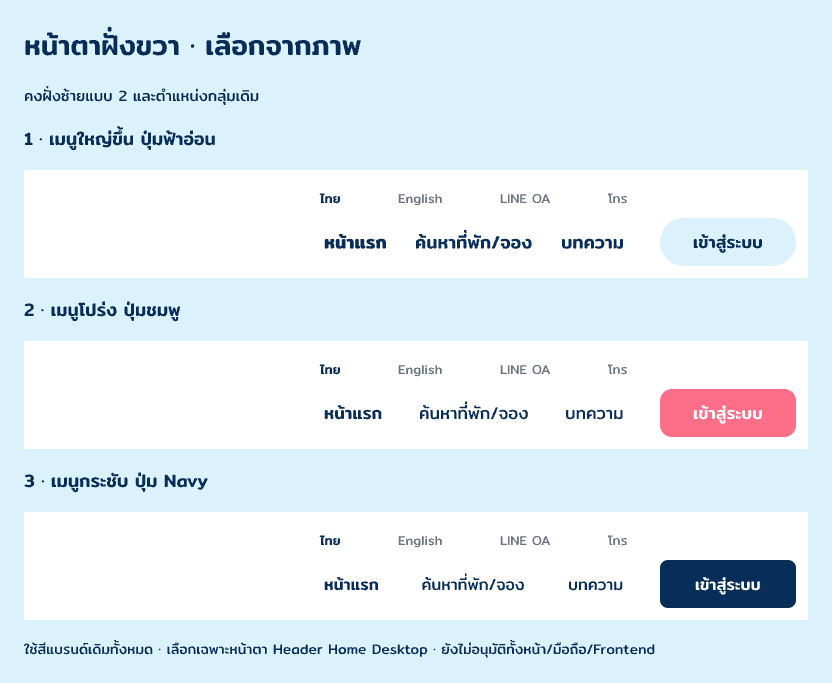

# Home Desktop · Header-r4 appearance choices

3 พฤศจิกายน 2026 · **สามข้อเสนอเฉพาะฝั่งขวา / รอเลือก**

เจ้าของเลือกข้อ 3 “ปรับหน้าตาอีก” หลังดู Header-r3 จึงคงฝั่งซ้าย Header-r2 และ layout กลุ่มเมนู/utility/เข้าสู่ระบบของ r3 แล้วทำตัวเลือกหน้าตาให้เทียบจากภาพ ไม่มีการเลือกแทนเจ้าของหรือใช้แทน Header หลัก

| ตัวเลือก | เมนูหลัก | ปุ่มเข้าสู่ระบบ |
|---|---|---|
| 1 · เมนูใหญ่ขึ้น ปุ่มฟ้าอ่อน | 18px / 500; Home 600 | #DBF2FC / Navy, 17px, radius 24 |
| 2 · เมนูโปร่ง ปุ่มชมพู | 17px / 400; Home 500 | #FD6E88 / White, 17px, radius 12 |
| 3 · เมนูกระชับ ปุ่ม Navy | 16px / 400; Home 500 | #072D59 / White, 16px, radius 8 |

Mitr, inventory ข้อความ, utility 13px, คอลัมน์เมนู 308px และปุ่ม 136×48px ใช้ร่วมกันทั้งสามแบบ สีทั้งหมดอยู่ใน palette เดิม การเลือกนี้เกี่ยวกับ Header/เข้าสู่ระบบเท่านั้น ไม่เปลี่ยน CTA ค้นหา/จองหรือสรุป design tokens ทั้งระบบ Option 2 เป็น Pink/White visual candidate ไม่ปิด OPEN-001 หรือรับรอง AA

Board `izn8X`; right-navigation variants `Zx15X`, `z5ja1`, `K9m1D` เป็น native editable layers ดู [snapshot](layer-snapshot.json) และ [verification](verification.json) ไม่มีภาพหรือโลโก้ใหม่

[ไฟล์ Pencil](C:/Users/chaym/.pencil/documents/5738e270-25e4-4bf2-9d22-fad4c0b58275/papaipak-ui.pen) · [บริบท Header-r3](../header-r3/README.md)

ยังรอเลือกตัวเลือก ไม่อนุมัติ Header/Home/F01-ui-1 ทั้งชุดหรือ Frontend
