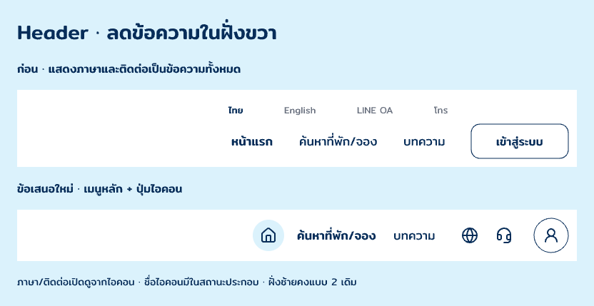

# Home Desktop · Header-r5 · icon utilities

3 พฤศจิกายน 2026 (Asia/Bangkok) · **ข้อเสนอใหม่หลังศึกษาเว็บจริง / รอเจ้าของตรวจ**

เจ้าของขอไปดูเว็บที่ใช้งานจริงและระบุว่า Header มีแต่ข้อความจนดูเยอะ จึงหยุดการเปลี่ยนสีปุ่มอย่างเดียว ศึกษา public Header ของ Airbnb, Booking.com และ Agoda แล้วเสนอการแบ่งเมนูหลักกับ utility controls ใหม่ คงฝั่งซ้ายของ Header-r2 ตามที่เจ้าของชอบ

[ดู Home ทั้งหน้า](q8eOsR.png) · [Header เต็ม](lDmWR.png) · [สถานะภาษา/ติดต่อ/ชื่อไอคอน](ggRyc.png) · [ไฟล์ Pencil](C:/Users/chaym/.pencil/documents/5738e270-25e4-4bf2-9d22-fad4c0b58275/papaipak-ui.pen)

## หลักฐานจากเว็บจริง

- [Airbnb](https://www.airbnb.com/): public Header HTML มีปุ่ม Search, Log in or sign up และ Main navigation menu ซึ่งไม่มี visible text แต่มี SVG และ aria-label
- [Booking.com](https://www.booking.com/): language selector ใช้ภาพธงและ aria-label; Customer support เป็น SVG link ไม่มี visible text ขณะที่ Sign in ยังคงเป็นข้อความ
- [Agoda](https://www.agoda.com/): มี primary text links หลายรายการและ Account Menu แบบ SVG จึงไม่สรุปว่าเว็บจริงทุกเว็บใช้แต่ไอคอน

ใช้ Firecrawl live fetch อ่านโครงสร้าง public Header เท่านั้น ไม่ Login หรือส่งค้นหา/จอง หลักฐานนี้เป็น DOM observations ไม่ใช่ผล usability test หรือข้ออ้างว่าลอกหน้าตาเว็บจริงมาทั้งชุด ดู [บันทึก sanitized](reference-evidence.json)

การจับภาพผ่าน Pencil browser ล้มเหลว/timeout ส่วน Firecrawl คืน screenshot URLs แต่ตัวเปิดภาพ remote ตรวจไม่ได้ จึงไม่อ้างว่าตรวจภาพต้นทางด้วยสายตาสำเร็จ ไม่ download ภาพ remote เพื่อข้ามข้อจำกัด และไม่เก็บ session/query tokens จาก HTML ในเอกสาร ภาพที่เปิดตรวจและส่งให้เจ้าของเป็น export ของแบบ papaipak ที่สร้างเอง

มีบอร์ดอ้างอิง `qy6ZD` พร้อม public browser nodes `B93ly`, `DYSxv`, `sSqT8` ใน Pencil เก็บไว้เพื่ออ้างอิง แยกจาก product UI

## ข้อเสนอที่เปลี่ยน

- ฝั่งขวาจากข้อความ 8 รายการ เหลือข้อความแสดงค้าง 2 เมนู: ค้นหาที่พัก/จอง และบทความ
- หน้าแรกเป็น house icon; ภาษาเป็น globe; ติดต่อเป็น headset; เข้าสู่ระบบเป็น user icon โดยมีภาพสถานะชื่อกำกับครบทั้งสี่
- ไทย/English อยู่ใน language popover; LINE OA/โทรอยู่ใน contact popover รายการเดิมยังมีครบ ไม่เพิ่ม currency, owner portal หรือช่องทางจริง
- Icon เข้าสู่ระบบส่งตรงไป WF-05 Login ตาม I-22 ไม่เพิ่ม Register-first หรือ account-menu step ก่อน Login
- เสนอให้ไอคอนมี accessible name และชื่อกำกับเมื่อ pointer/focus อยู่ที่ปุ่ม; popovers ต้องมีทางปิดและคืน focus ในขั้น implementation ยังไม่ได้เชื่อมทำงานใน Pencil
- Right controls จัดแถวเดียวในพื้นที่เดิม Header สูง 124px ฟอนต์ Mitr, palette และ CTA ค้นหาชมพูเดิม/ข้อความขาวคงเดิม

การย้ายข้อความ utility เข้า popovers เป็นข้อเสนอ presentation เฉพาะ Header ที่ยังรอเจ้าของเลือก ไม่แก้ Wireframe ต้นทางหรือรับรอง G2 จากการศึกษาครั้งนี้

## Source และสถานะ

Candidate Home `q8eOsR`, Header `lDmWR`, right navigation `IlJuQ`, บอร์ดก่อน–หลัง `feEd1`, supporting states `ggRyc` เป็น native editable layers ดู [snapshot](layer-snapshot.json) และ [ผลตรวจ](verification.json) ใช้ [ภาพศึกษาเดิม](../images/) ไม่มีการคัดลอกโลโก้ สี ฟอนต์ หรือ assets ของเว็บอ้างอิงมาเป็นแบรนด์ papaipak

ยังไม่อนุมัติ Header-r5 หรือ Home ทั้งหน้า ยังไม่ใช้แทน Header หลัก/มือถือ ไม่เริ่ม Frontend และ OPEN-001 ยังเปิด
