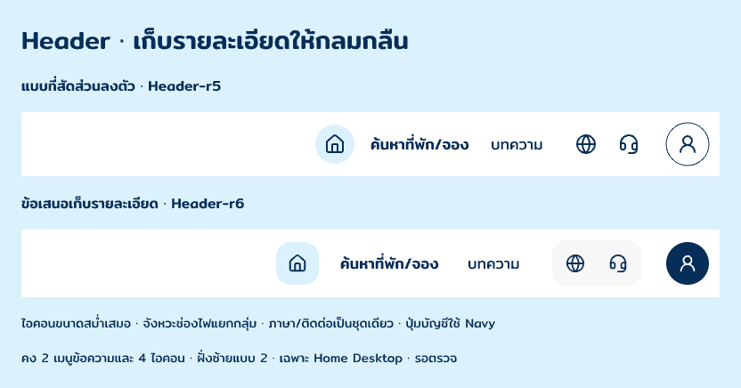

# Home Desktop · Header-r6 · visual polish

3 พฤศจิกายน 2026 · **ร่างเก็บรายละเอียด / รอเจ้าของตรวจ**

เจ้าของระบุ “แบบใหม่พอดีแต่ออกแบบให้ดีกว่านี้อีก” จึงใช้โครง compact ของ Header-r5 ต่อ โดยไม่เพิ่มรายการหรือข้อความ เก็บรายละเอียดเฉพาะฝั่งขวา และคงฝั่งซ้ายแบบ 2 ตามเดิม คำตอบนี้ยังไม่ใช่ final version approval

[ดูบนหน้า Home](SwVyz.png) · [Header เต็ม](b8hoj.png) · [รายละเอียดสถานะ](ia2em.png) · [Pencil](C:/Users/chaym/.pencil/documents/5738e270-25e4-4bf2-9d22-fad4c0b58275/papaipak-ui.pen)

## รายละเอียดที่ปรับ

- คง 2 เมนูข้อความและ 4 ไอคอน หน้าที่และ inventory เดิมทั้งหมด
- ใช้ไอคอนขนาด 22px สม่ำเสมอ ปรับ Home target เป็น 48×48px มุม 16px และเพิ่มช่องไฟของพื้นที่เมนูที่มีข้อความ
- แยกกลุ่มหลักด้วย gap 28px จัดภาษา/ติดต่อเป็น toolbar เดียว พื้น #F7F7F7 ขนาดตามเนื้อหา 100×52px ภายในยังเป็น targets 44×44px แยกกัน
- ปุ่มเข้าสู่ระบบ 48px ใช้ Navy กับ user icon สีขาว เพื่อแยก action นี้จากเครื่องมือรอง โดยยังเปิด Login ก่อนตาม I-22
- Header สูง 124px และยังใช้ Mitr, palette เดิมกับปุ่มค้นหาชมพูเดิม/ข้อความขาว ไม่เปลี่ยน Hero หรือส่วนอื่นใน Home
- มีตัวอย่างสถานะปกติ, hover ที่ภาษา และ keyboard focus ที่บัญชี แยกกัน ปกติไม่แสดง tooltip; focus ring บัญชีใช้ Navy 2px พร้อมพื้นที่ขาวแยกจากปุ่ม

Target sizes และสถานะเหล่านี้เป็น design proposal ไม่ใช่ผลทดสอบ accessibility หรือ interaction จริง Language/contact popovers และชื่อกำกับไอคอนใช้ inventory ของ [Header-r5](../header-r5/README.md) ต่อ ไม่มี account-menu step เพิ่มก่อน Login

## Source และการตรวจ

Candidate Home `SwVyz`, Header `b8hoj`, right group `D7aw4h`, บอร์ดเทียบ `z8lsX`, บอร์ดสถานะ `ia2em` เป็น native editable layers ดู [snapshot](layer-snapshot.json) และ [verification](verification.json) Assets ใช้ [ชุดเดิม](../images/) กับ URI ในไฟล์ native ไม่สร้างภาพ/โลโก้/ฟอนต์ใหม่

ตรวจ screenshot ของบอร์ดเปรียบเทียบ สถานะ และ Home ทั้งหน้าแล้ว เทียบข้อมูลฝั่งซ้ายและส่วนอื่นกับ r5 แยก ยังไม่ใช้แทน Header หลัก/มือถือหรือหน้าอื่น ไม่มี Frontend และ OPEN-001 ยังเปิด
