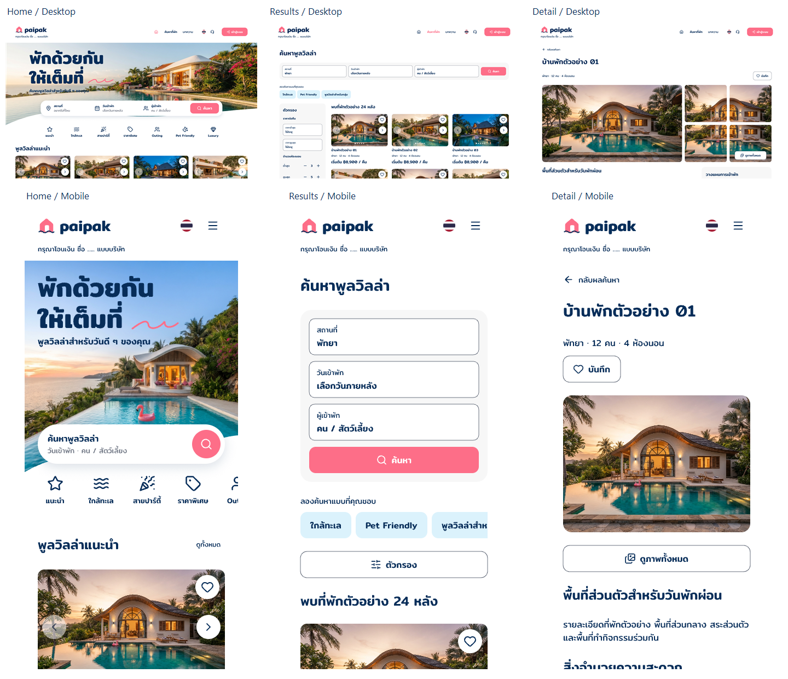

# F-01 · F01-ui-2

รุ่นปัจจุบันคือ [F01-ui-3](../f01-ui-3/README.md) เปลี่ยนชื่อที่แสดงเป็น papaipak และใช้ธงภาษา/โลโก้ LINE ตามแบบที่เจ้าของเลือก ภาพและ JSON ชุด ui-2 ด้านล่างเป็นหลักฐานก่อน rollout นี้

Header open states ล่าสุด: [Header-icons-r4](header-icons-r4/README.md) เปลี่ยน EN เป็นธง UK วงกลมและใช้โลโก้ LINE ทางการ ต่อจาก [Header-reference-r3](header-reference-r3/README.md) ที่ศึกษา [ตัวอย่างเว็บจริง](header-reference-research/README.md) ก่อนปรับภาษา/ติดต่อ ยังรอตรวจรับ Header default และ Main Home-r7 ไม่เปลี่ยน

3 พฤศจิกายน 2026 · แบบ static ใน Pencil · รอเจ้าของตรวจรับรุ่นรวม

รอบตรวจทีละหน้าล่าสุด: [Home Desktop-r7](home-desktop-r7/README.md) เพิ่มแถวบ้านครบ 7 หมวดเดิม แต่ละแถวมี controls แยก โดยคงส่วนบนและการ์ด r6 ยังรอตรวจรับหน้า Home ภาพรวมด้านล่างเป็นชุดก่อนแก้รายหน้า; ลิงก์ Home Desktop ในตารางชี้รุ่นล่าสุด

นำ Header-r11 ที่เจ้าของอนุมัติบน Home Desktop ไปปรับให้ครบ F-01 ตามคำสั่ง “โอเคเอาไปปรับให้ครบ” ครอบคลุม Header ทุกจุดที่ปรากฏ, โลโก้ใน Footer, เมนูมือถือ และสถานะภาษา/ติดต่อ คงเนื้อหาและ UX เดิม

[เปิดไฟล์ Pencil](C:/Users/chaym/.pencil/documents/5738e270-25e4-4bf2-9d22-fad4c0b58275/papaipak-ui.pen) · เริ่มหน้า Home Desktop `A1ks07` ที่ 0,0 หรือบอร์ด `w9QeyO` ชื่อ **F01 · START HERE · A UI review-2**

## สิ่งที่ปรับ

- Desktop Home, Results, Detail, Applied filters และ Results หน้า 2 ใช้โลโก้สมมติ ชมพู/ขาว ธงไทยวงกลม 22px และคำว่า “ค้นหาที่พัก” ร่วมกัน ปรับ active navigation ตามหน้า
- Mobile ใช้โลโก้สมมติขนาด 32px คู่กับชื่อ papaipak, ธงไทย 22px และปุ่มเมนูขนาดกด 44px เมนูเปิดมีรายการเดิมและปุ่ม “เข้าสู่ระบบ” สีชมพู ไม่มี avatar หรือเมนูสมาชิก
- อัปเดต Header ใน Detail viewport และ Loading/Empty/Error ของมือถือด้วย โดยเก็บความสูง Header 98px และแถบจองด้านล่างเดิม
- Footer ที่มี wordmark ทั้ง 10 จุดใช้โลโก้สมมติชุดเดียวกัน ไม่มีการเพิ่มลิงก์หรือเปลี่ยนข้อมูลติดต่อ
- แกลเลอรี แผงตัวกรอง และแผงสถานะที่ใช้แถบควบคุมเฉพาะยังคงโครงเดิม ไม่ใส่ navigation เพิ่ม

## หน้าสำหรับตรวจ

ภาพรวมตัดเฉพาะส่วนบนของหน้าเพื่อเทียบ Desktop/Mobile ดูหน้าเต็มได้จากลิงก์ด้านล่าง

| หน้า | Desktop | Mobile |
|---|---|---|
| Home | [ดูภาพล่าสุด](home-desktop-r7/A1ks07.png) | [ดูภาพ](PiA4h.png) |
| ผลค้นหา | [ดูภาพ](osaIa.png) | [ดูภาพ](L8ev6.png) |
| รายละเอียดบ้าน | [ดูภาพ](qcEOf.png) | [ดูภาพ](S3VaWy.png) |
| ใช้ตัวกรองแล้ว | [ดูภาพ](NmzZ4.png) | [ดูภาพ](YQRxl.png) |
| ผลค้นหาหน้า 2 | [ดูภาพ](HpR7z.png) | [ดูภาพ](P62IV.png) |
| เมนู / Utility states | [ภาษา ติดต่อ และโฟกัส](h9ExoH.png) | [เมนูเปิด](E3Tu4.png) |
| Feedback / Sticky viewport | [Feedback เดิม](Qu46v.png) | [Loading/Empty/Error](O5lUa1.png), [Detail viewport](yL7bS.png) |

[รวม Header ทุกจุด](headers-contact-sheet.png) · [รวมโลโก้ Footer](footers-contact-sheet.png) · [รายการครบ 29 review groups](review-manifest.json) · [ผลตรวจ](verification.json) · [QA และข้อจำกัด](qa.md)

แพ็กเกจมี 29 review groups และ 3,460 native nodes เพิ่มบอร์ด Header utility states จากชุดเดิมหนึ่งกลุ่ม ไม่ใช่การเพิ่ม route สถานะและ flow coverage เดิม 15 แถวอ้างอิง [ชุด F01-ui-1](../f01-ui-1/README.md)

## หลักฐานและสถานะอนุมัติ

[สำเนาก่อนปรับ](before-snapshot.json) เก็บ 28 review groups เดิมและบอร์ดสถานะ ส่วน [สำเนาหลังปรับ](editable-snapshot.json) เก็บ 29 review groups และบอร์ดสถานะ พร้อม path geometry และ variables ทั้งสองเป็น JSON สำหรับใช้ผ่าน Pencil MCP ไม่ใช่ไฟล์ .pen เก็บภาพและ fixtures เดิมไว้ที่ [ชุดข้อมูล](../f01-ui-1/fixtures.json) และ [assets](../f01-ui-1/images/) URL ของรูปใน snapshot ยึดตำแหน่ง assets ของ native source ต้องใช้ร่วมกันเมื่อสร้างคืน

Header-r11 ของ Home Desktop ได้รับอนุมัติด้วยข้อความ “โอเคเลย” การอนุมัตินั้นไม่ครอบคลุมการตรวจรับรุ่น F01-ui-2 ทั้งชุดหรือมือถือที่ปรับในรอบนี้ โลโก้ยังเป็น placeholder สำหรับจัดวาง ไม่ใช่โลโก้แบรนด์ถาวร

ภาพบ้านเป็นภาพศึกษาที่สร้างด้วย AI และข้อมูลเป็น fixtures เดิม OPEN-001 เรื่องข้อความขาวบนชมพูยังเปิด ร่าง foundation-1 ยังต้องปรับให้สอดคล้องกับ A การทำรอบนี้ไม่ทำให้ DSD-001 เสร็จ ไม่แก้หรืออนุมัติ UXD-002 review-5 และไม่มี Frontend/backend/deploy ต้องให้เจ้าของอนุมัติแบบและเวอร์ชันที่เกี่ยวข้องก่อน Frontend แยกอีกขั้น
