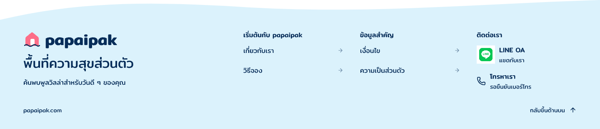

# Footer-contact-column-r2

5 พฤศจิกายน 2026 · เจ้าของเลือกคอลัมน์ติดต่อฝั่งขวา · ภาพปรับใหม่รอตรวจ

ประวัติ: หลังดูภาพนี้เจ้าของเลือก `3` ให้ลดขนาดไอคอนและช่องไฟ จึงแก้ root `kengy` เป็น [Footer-contact-column-r3](../footer-contact-column-r3/README.md) แล้ว ภาพและ snapshot r2 นี้เป็นหลักฐานก่อนแก้ ไม่ใช่รุ่นที่ตรวจอยู่ปัจจุบัน

เจ้าของเลือก `3` ต่อคำถามตำแหน่งช่องทางติดต่อ จึงจัด Footer เป็นฝั่งแบรนด์ทางซ้าย และสามคอลัมน์ทางขวา: เริ่มต้นกับ papaipak, ข้อมูลสำคัญ, ติดต่อเรา LINE และโทรศัพท์อยู่ในคอลัมน์ติดต่อ เห็นทั้งสองช่องทางทันที ไม่มีปุ่มเปิดแผงอีกชั้น ดู [ตัวเลือกที่เจ้าของเลือก](owner-layout-choice.json)

แก้ review frame `kengy` เดิมโดยตรงเป็นรุ่น r2 ขนาด 1440×312 ภาพและ snapshot ของ [r1](../footer-inline-r1/README.md) เก็บเป็นประวัติ Root `kengy` ปัจจุบันจึงเป็น r2 แล้ว ไม่ใช่ภาพ r1 เดิม

ย้ายโลโก้มาอยู่เหนือข้อความฝั่งแบรนด์ เอาแถวโลโก้/ติดต่อเดิมออก ลดความกว้างสองคอลัมน์เมนูจาก 264 เป็น 240px และเพิ่มคอลัมน์ติดต่อกว้าง 240px เว้นคอลัมน์ 40px ข้อความเดิมทั้งสี่ลิงก์และการเปิดแท็บเดิมคงไว้ คลื่นเข้า Footer โดเมนและกลับขึ้นบนคงเดิม Header และ Main Home ยังไม่เปลี่ยน

ใช้ไอคอน LINE ทางการพร้อม clear space เดิม โทรศัพท์ใช้ไอคอนเดิม บัญชี LINE และเบอร์จริงยังไม่ยืนยัน จึงไม่แต่งข้อมูลหรือใส่ลิงก์ใช้งานสมมติ

ตรวจ native PNG ที่ 1440px แล้วเห็นครบ ไม่มีการซ้อนหรือตัดที่เห็นในภาพ อย่างไรก็ตาม `Get` ยังมี bounds diagnostics ที่ไม่ตรงกับภาพ native export เช่นเดียวกับ r1 เก็บ [ผลตรวจ](bounds-diagnostics.json) ไว้ ไม่อ้างว่าผ่าน structural bounds หรือ interaction test

[Manifest](review-manifest.json) · [Native snapshot](editable-snapshot.json)

การเลือกคอลัมน์เป็นคำสั่งแก้ ไม่ใช่การรับภาพ r2 ล่วงหน้า ยังต้องตรวจภาพนี้ก่อนรวมลง Home review copy Mobile พัก OPEN-001 เปิด ไม่อนุมัติ Frontend หรือปิด DSD-001 จากรอบนี้
