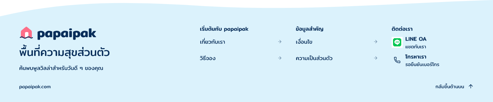

# Footer-contact-column-r3

5 พฤศจิกายน 2026 · ลดขนาดไอคอนและช่องไฟตามตัวเลือก 3 · ภาพใหม่รอตรวจ

ผลตรวจภายหลัง: เจ้าของตอบ “1 แต่ให้แสดงเป็นข้อมูลจริงจำลอง” รับ layout นี้พร้อมขอแทนข้อความรอยืนยันด้วยข้อมูลจำลอง จึงเปลี่ยนข้อความใน root `kengy` เป็น [r4](../footer-contact-column-r4/README.md) แล้ว เก็บภาพและ snapshot r3 นี้เป็นหลักฐานก่อนเปลี่ยนเนื้อหา ดู [หลักฐานการรับ](../footer-contact-column-r4/owner-layout-acceptance.json)

แก้ review frame `kengy` โดยตรงจาก r2 คงคอลัมน์ติดต่อฝั่งขวากว้าง 240px ลด LINE จาก 32 เป็น 24px พร้อมกรอบ clear space จาก 44 เป็น 32px โทรศัพท์จาก 22 เป็น 20px และเพิ่มพื้นที่จัดแนวไอคอน 32px ให้ข้อความทั้งสองช่องทางเริ่มตรงกัน คงไอคอน LINE ทางการและสีเดิม

ลดช่องระหว่างหัวข้อ/ช่องทางจาก 8 เป็น 4px ความสูงรายการจาก 56 เป็น 48px ช่องระหว่างไอคอนกับข้อความจาก 10 เป็น 8px และระหว่างชื่อกับคำอธิบายจาก 2 เป็น 0px ตัวอักษรยัง 16/14px เพื่อให้อ่านได้ตามเดิม ข้อความ โลโก้ เมนู คลื่น โดเมน และกลับขึ้นบนคงเนื้อหาเดิม Footer สูงตามเนื้อหาเหลือ 299px ที่ความกว้าง 1440px

เปิดตรวจ native PNG เต็มแล้ว ข้อมูลทั้งสองช่องทางเห็นครบและข้อความเริ่มแนวเดียวกัน ไม่พบการทับหรือถูกตัดในภาพ `Get` ยังรายงาน bounds บางจุดต่างจากภาพ export ตามปัญหาที่บันทึกตั้งแต่ r1 จึงยังไม่อ้างว่าผ่าน structural bounds หรือ functional check ดู [diagnostics](bounds-diagnostics.json)

[คำสั่งแก้ของเจ้าของ](owner-spacing-choice.json) · [Manifest](review-manifest.json) · [Native snapshot](editable-snapshot.json) · [r2 ก่อนแก้](../footer-contact-column-r2/README.md)

บัญชี LINE และเบอร์จริงยังรอยืนยัน ไม่เพิ่มข้อมูลหรือลิงก์ใช้งานสมมติ Header และ Main Home ยังไม่เปลี่ยน ต้องตรวจ appearance r3 ก่อนรวมหน้า ไม่ถือว่าตัวเลือก 3 รับภาพที่ยังไม่เห็น Mobile พัก OPEN-001 เปิด ไม่เริ่ม Frontend หรือปิด DSD-001
