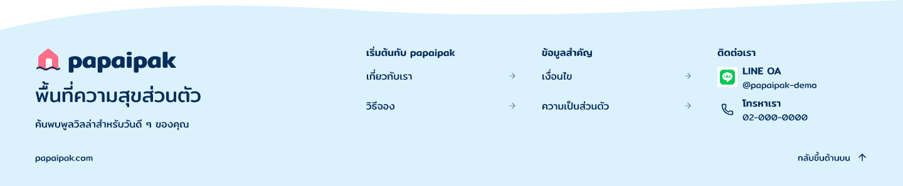

# Footer-contact-column-r4

5 พฤศจิกายน 2026 · เจ้าของรับ layout r3 พร้อมขอข้อมูลติดต่อจำลอง

หลังดูภาพ r4 เจ้าของยืนยัน “โอเคฉันอนุมัติ” รับ appearance ของ Footer รุ่นนี้พร้อมข้อมูลจำลอง ดู [หลักฐานพร้อม hash ภาพ](owner-footer-approval.json) เป็นการรับเฉพาะ Footer ที่แสดง ไม่ขยายเป็น Home/foundation ทั้งชุด การกดจริง หรือ Frontend authorization

เจ้าของตอบ “1 แต่ให้แสดงเป็นข้อมูลจริงจำลอง” จึงคง layout ขนาดไอคอนและช่องไฟของ r3 เปลี่ยนเฉพาะข้อความใต้ LINE เป็น `@papaipak-demo` และใต้โทรศัพท์เป็น `02-000-0000` ข้อมูลทั้งสองเป็น fixture สำหรับดูแบบ ไม่ใช่บัญชีหรือเบอร์ธุรกิจที่ตรวจสอบแล้ว ไม่มีการผูก href, LINE URL หรือ tel ที่ใช้งานจริง

Native review frame `kengy` ปัจจุบันเป็น r4 ขนาด 1440×299 ภาพและ snapshot ของ [r3](../footer-contact-column-r3/README.md) เก็บเป็นหลักฐาน layout ที่เจ้าของรับ คำขอแก้ข้อความไม่ใช่การตรวจรับ Home/foundation ทั้งชุดหรืออนุญาต Frontend ไม่ถามเลือก layout เดิมซ้ำ

เปิดตรวจ native PNG แล้วข้อมูลจำลองเห็นครบ ไม่มีการทับหรือตัดที่เห็นในภาพ คงข้อจำกัดของ bounds diagnostics ที่ไม่ตรงกับภาพ export จากรอบเดิม และยังไม่ได้ทดสอบการกด/keyboard/ปลายทางจริง Header, Main Home และ variables ไม่เปลี่ยน

[หลักฐานการรับ layout และคำขอแก้](owner-layout-acceptance.json) · [Manifest](review-manifest.json) · [Native snapshot](editable-snapshot.json) · [Bounds diagnostics](bounds-diagnostics.json)

ถัดไปตามแผนคือรวมบทความและ states สำหรับ R1 ก่อนตรวจ Home ทั้งหน้า ข้อมูลติดต่อจริงยังต้องยืนยันภายหลัง Mobile พัก OPEN-001 เปิด
