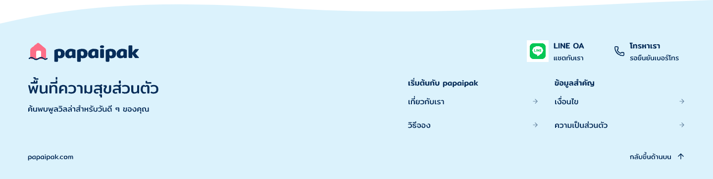

# Footer-inline-r1

บันทึก 5 พฤศจิกายน 2026 · เจ้าของยืนยันให้เห็นช่องทางติดต่อแยกกัน · appearance รอตรวจ

ประวัติ: เจ้าของเลือกให้จัดช่องทางเป็นคอลัมน์ฝั่งขวาต่อ จึงแก้ review frame `kengy` เป็น r2 และต่อมาลดไอคอน/ช่องไฟเป็น [Footer-contact-column-r3](../footer-contact-column-r3/README.md) ภาพและ snapshot r1 ในโฟลเดอร์นี้เป็นหลักฐานก่อนแก้ ไม่ใช่ภาพของ native root ปัจจุบัน

เจ้าของตอบ Q8 โดยขอให้เขียนแยกไว้ ไม่ใช้ปุ่มติดต่อเพียงปุ่มเดียวเพื่อไม่ต้องกดเปิดอีกชั้น จึงทำ review copy ของ Footer ใน Pencil เป็น LINE OA และโทรศัพท์ที่มองเห็นได้ทันที ช่องทางแต่ละรายการตั้งใจให้เปิดแชต/โทรโดยตรงเมื่อได้ข้อมูลจริง Header contact ยังคงเดิม ดู [ข้อสรุปเจ้าของ](owner-direct-contact-decision.json)

Native root `kengy` ขนาด 1440×364 คัดจาก `b5ltx` ใน `papaipak-ui.pen` คงคลื่นเข้า Footer แบรนด์ ข้อความ เมนู โดเมนและกลับขึ้นบน เปลี่ยนเฉพาะช่องทางติดต่อและเพิ่มความสูงแถวบนจาก 48 เป็น 64px ใช้ไอคอน LINE ทางการจาก asset ที่เลือกไว้พร้อม clear space เดิม ไม่วาดโลโก้ใหม่

บัญชี LINE OA และเบอร์จริงยังไม่ยืนยัน ภาพใช้ข้อความแชตกับเรา/รอยืนยันเบอร์โทร ไม่มีการแต่งบัญชี เบอร์ หรือใส่ลิงก์ที่อ้างว่าทำงานแล้ว

เปิดตรวจ native PNG ที่ 1440px แล้วเห็นข้อมูลครบ ไม่พบการทับกันหรือถูกตัดในภาพ เทียบสี่ส่วนที่ต้องคงเดิมกับ snapshot ต้นทางโดยไม่นับ IDs แล้วตรงกัน อย่างไรก็ตาม `Get` ยังรายงาน contact descendants ว่า clipped ต่างจากภาพ export แม้ปรับ alignment แล้ว เก็บ [diagnostics](bounds-diagnostics.json) ไว้และยังไม่อ้างว่าผ่าน structural bounds check

[Manifest](review-manifest.json) · [snapshot หลังแก้](editable-snapshot.json) · [snapshot ก่อนแก้](before-snapshot.json)

ยังไม่รวมลง Main Home หรือเปลี่ยน Footer ที่รับเดิมเป็นแบบรับใหม่โดยอัตโนมัติ ให้เจ้าของตรวจ appearance ของภาพนี้ก่อน จากนั้นนำไปรวมใน Home review copy ตามแผน ไม่ใช่การรับ Home/DSD-001 ทั้งชุดหรือ Frontend Mobile ยังพักและ OPEN-001 ยังเปิด
