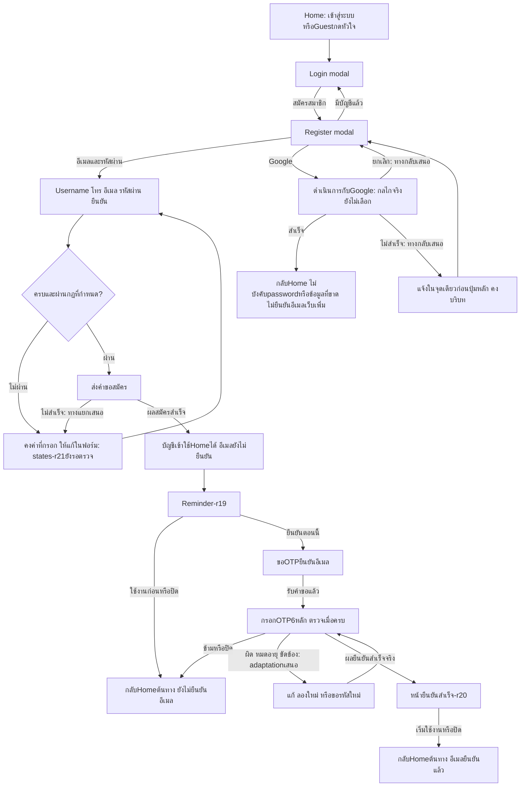

# Flow สมัครสมาชิกจากHome

รุ่นr22 · รับflowตาม [หลักฐาน](owner-signup-flow-acceptance.json) เฉพาะลำดับในภาพ ไม่รับRegister states-r21หรือG2รวม

กฎmin8+confirmationตรง/usernameซ้ำได้ใช้ตามข้อสรุปเดิม ไม่มีรูปแบบโทรหรือชื่อใหม่ ปิดก่อนสมัครสำเร็จกลับoriginโดยไม่สื่อว่าสร้างบัญชีสำเร็จ การเปิดจากGuest heartไม่ถือว่าsavefavoriteเองในกราฟนี้

การกลับorigin/คงค่าครอบคลุมflowต่อเนื่องเท่านั้น ไม่กู้Booking Intentหลังreload/ปิดแท็บ/หมดอายุตามQ-03 ไม่มีการออกแบบBooking/Account/Profile/provider UIหรือทำAuthจริง

สถานะที่ระบุเสนอและรายละเอียดprovider/อายุOTP/quota/คำขอขัดข้องยังต้องตรวจร่วมกับG2โดยไม่อ้างว่าลูกศรคือระบบที่implementแล้ว
