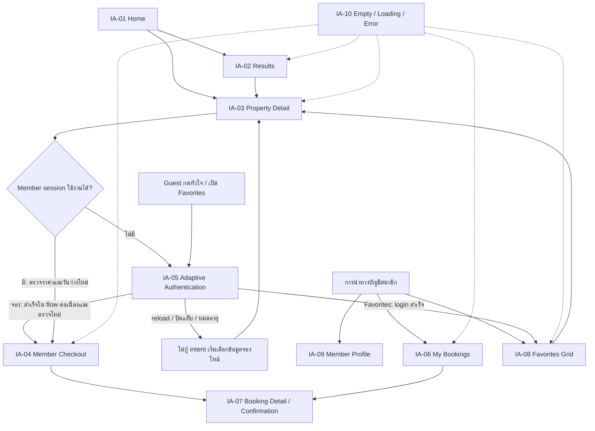

# UXD-001 — โครงสร้างหน้าและการนำทาง

วันที่จัดทำ/ปรับปรุง: 2 พฤศจิกายน 2026 · Asia/Bangkok · รุ่น: review-2 · สถานะ: ภูอนุมัติแล้ว

ตรวจรับเมื่อ 2 พฤศจิกายน 2026 จากข้อความ “อนุมัติ UXD-001 review-2” ดู [บันทึกตรวจรับ](../../../tasks/design/UXD-001.md#owner-acceptance) ครอบคลุมเอกสาร UX/IA เท่านั้น ยังไม่ใช่การอนุมัติหน้าจอหรือเริ่ม task ถัดไป

เป็นคู่กับ [journey-map.md](journey-map.md) และ [edge-flows.md](edge-flows.md) จัดทำตาม [task packet](../../../tasks/design/UXD-001.md) และ [ขอบเขต UX/UI ที่ยืนยันแล้ว](../approved-ux-ui-scope.md) ไม่เปลี่ยนโครงสร้างหน้าที่เลือกไว้และยังไม่กำหนด URL ใหม่เป็นข้อผูกมัดทางเทคนิค

## 1. รายการหน้าเทียบสิ่งที่มีจริง

`IA-*` เป็นรหัสอ้างอิงภายในเอกสาร ไม่ใช่ Task ID หรือ application route ใหม่

| รหัส / template ที่เลือกไว้ | ผู้ใช้และหน้าที่ | สิ่งที่มีในโปรเจกต์ | สิ่งที่ต้องมีตามเป้าหมาย |
|---|---|---|---|
| IA-01 Home — Premium Marketplace | Guest/Member ค้นพบที่พัก | `/` มี hero, ค้นหา, 4 กลุ่มรายการที่พักจำลอง | ทิศทางแบรนด์ใหม่ เมนูลัด 7 หมวด และ component ตามแบบที่อนุมัติภายหลัง |
| IA-02 Results — Modern Marketplace | Guest/Member ค้นหา/กรอง/เปลี่ยนหน้า | section ผลค้นหาใน `/`; ยังไม่มี route แยก | Suggested Search Chips, sidebar Desktop/drawer Mobile, Apply Filters และ pagination ที่รักษาสถานะใน URL |
| IA-03 Property Detail — Premium Booking Focus | Guest/Member ดูที่พักและเริ่มจอง | หน้าต่างรูปเดียว ข้อมูลจำลอง ราคา ไม่มีการจอง | Gallery grid, รายละเอียดซ้าย/booking panel ขวา และสถานะราคา/วันว่างที่ตรวจสอบได้ |
| IA-04 Booking/Checkout — Premium Member Checkout | Member ตรวจรายการแล้วชำระเงิน | ไม่มี | ข้อมูลติดต่อจากบัญชี ตรวจ/แก้รายการ และขั้นชำระเงินแยกกัน |
| IA-05 Login/Register — Adaptive Authentication | Guest เข้าสู่ระบบ/สมัครสมาชิก; Member ที่ต้องยืนยันใหม่ | Dialog เดโมทั้ง Desktop/Mobile; ไม่สร้างบัญชีหรือ session | Desktop modal/Mobile fullscreen; คืน intent เฉพาะ flow ต่อเนื่องตาม Q-03 และใช้ทางกลับที่ยืนยันใน Q-02 |
| IA-06 My Bookings — Tabbed Booking List | Member ดูรายการจองของตน | ไม่มี | แท็บ upcoming/past/cancelled และเข้าไปดูแต่ละรายการ |
| IA-07 Booking Detail/Confirmation — Hybrid Confirmation | Member ดูรายละเอียดรายการที่มีสิทธิ์ | ไม่มี | ข้อมูลจอง สถานะจองและชำระเงินแยกกัน รวมสถานะที่ยังไม่ยืนยัน |
| IA-08 Favorites — Favorites Grid | ต้อง login เพื่อดูหรือจัดการรายการโปรดตาม Q-01 | หน้าต่างรายการชั่วคราว ดูได้โดยไม่ login และล้างเมื่อ reload ซึ่งต่างจากเป้าหมายใหม่ | Grid ใช้ property card ร่วมกัน ไม่มี collections/comparison และไม่มี Guest favorites ชั่วคราว |
| IA-09 Member Profile — Modern Split Profile | Member ดู/แก้ข้อมูลบัญชีของตน | ไม่มี | Navigation ซ้าย รายละเอียดขวา และการปรับสำหรับ Mobile |
| IA-10 Empty/Loading/Error — Contextual Premium States | ผู้ใช้ทุกกลุ่มตามหน้าที่กำลังใช้งาน | มี no-results, empty favorites และข้อความฟอร์มเดโมบางส่วน | กลุ่มสถานะประกอบแต่ละหน้า ไม่ใช่ route หน้าเดียวหรือหน้าเว็บลำดับที่สิบที่ต้องสร้างเสมอ |

ทะเบียนนี้ยึด `PAGE-001` ถึง `PAGE-010` และ `UXF-003` ใน [registry](../../decisions/registry.yaml) การมีหน้าต่างเดโมไม่เท่ากับมีหน้า/ระบบเป้าหมายที่เสร็จแล้ว

### โครงสร้างเป้าหมายระดับตรรกะ



แผนผังแสดงความสัมพันธ์ของหน้า ไม่ใช่ลำดับปฏิบัติที่ข้ามการตรวจข้อมูลจอง ดูเงื่อนไขครบถ้วนใน J-02/J-03 และ edge-flows

## 2. ทะเบียนการนำทางปัจจุบัน

| บริเวณ / จุดกด | ผลปัจจุบันจากโค้ด | การจัดการใน UXD-001 |
|---|---|---|
| โลโก้ Header/Footer | ลิงก์ `#` ในหน้าเดิม | จับคู่กับ Home; ยังไม่กำหนดระบบ routing ใหม่ |
| Header: THB / ภาษาไทย | เปิดข้อความเดโม แสดง THB/ไทยเท่านั้น | บันทึกไว้ ไม่ขยายเป็นระบบหลายภาษา/หลายสกุลเงิน |
| Header: หัวใจ | เปิดรายการโปรดชั่วคราว | จับคู่ IA-08; เป้าหมายต้อง login ก่อนใช้งานตาม Q-01 |
| Header: LINE | เปิดข้อความว่ายังไม่กำหนดบัญชีติดต่อ | ไม่สร้างบัญชีหรือลิงก์ติดต่อจริง |
| Header: เข้าสู่ระบบ/ลงทะเบียน | เปิด AuthDemo | จับคู่ IA-05 พร้อมช่องว่างเรื่อง session/return intent |
| Hero search | กรองรายการแล้วเลื่อนและโฟกัสที่หัวข้อผลค้นหาในหน้าเดิม | จับคู่ IA-02; เก็บพฤติกรรมค้นหาโดยไม่บังคับวัน |
| การ์ด / หัวใจบนการ์ด | เปิดรายละเอียดตัวอย่าง / สลับที่พักโปรดแยกกัน | จับคู่ IA-03 และ IA-08; ไม่ทำให้กดหัวใจแล้วเปิดการ์ดพร้อมกัน |
| ดูทั้งหมดในทั้ง 4 กลุ่ม | เปิดข้อความเดโม ยังไม่ไปหน้าผลลัพธ์ | เสนอให้ใช้เป็นทางเข้า Results ตามกลุ่ม/หมวดที่เกี่ยวข้องเมื่อมี mapping ที่ยืนยันแล้ว |
| Footer ค้นหาวิลล่า | ค้นหาพูลวิลล่า, พัทยา, หัวหิน, เขาใหญ่, เชียงใหม่, วิลล่า 4 ห้องนอน+ เปิดข้อความตัวอย่าง | เก็บเป็น inventory; การ map เป็น filter จริงต้องตรงกับข้อมูลที่มี |
| Footer เกี่ยวกับเรา | เกี่ยวกับ paipak, วิธีจอง, เงื่อนไขจอง, ความเป็นส่วนตัว, ข้อกำหนด, ลงประกาศวิลล่า เปิดข้อความ | เก็บเป็นรายการเนื้อหาประกอบ; ปุ่มลงประกาศไม่ใช่สิทธิ์สร้าง owner portal |
| Footer ช่องทางติดต่อ/โซเชียล | Facebook, TikTok, Instagram, YouTube, LINE, โทรศัพท์ และสอบถามผ่าน LINE เป็นข้อความเดโม | รอข้อมูลช่องทางจริง ไม่คัดลอก contacts จากเว็บอ้างอิง |
| Footer legal/FAQ/ตั้งค่าคุกกี้ | Legal/FAQ เป็นข้อความ ส่วนคุกกี้เปิดสวิตช์เดโม | ไม่ตีความเป็นนโยบายจริงหรือระบบ consent ที่ใช้งานแล้ว |

แหล่งหลัก: [app/homepage.tsx](../../../app/homepage.tsx), [components/home-search.tsx](../../../components/home-search.tsx), [components/auth-demo.tsx](../../../components/auth-demo.tsx) บางจุดตรวจด้วย browser ตามตารางหลักฐาน ส่วนที่เหลือเป็นการอ่าน source ไม่อ้างว่าได้กดทุกเมนู

### หมวดที่พักเป้าหมาย

ใช้ 7 หมวดตาม `UX-002`: พูลวิลล่าแนะนำ, พูลวิลล่าใกล้ทะเล, พูลวิลล่าสายปาร์ตี้, พูลวิลล่าราคาพิเศษ, พูลวิลล่า Outing, พูลวิลล่า Pet Friendly และพูลวิลล่า Luxury

ปัจจุบันเป็นกลุ่ม “แนะนำ/เปิดใหม่”, “ติดหาด/ใกล้หาด”, “ราคาสุดคุ้ม”, “พูลวิลล่าทั้งหมด” ตาม [home-data.ts](../../../app/home-data.ts) ยังไม่ใช่เมนูลัด 7 หมวด และ fixtures ยังไม่มีข้อมูลครบพอให้จัดหมวดใหม่อย่างน่าเชื่อถือ ไม่แปลงกลุ่มเดิมเป็นหมวดใหม่โดยเดา

## 3. ผู้ใช้ บริบท และการเข้าถึง

| บริบท | การนำทางและข้อมูลที่ต้องรักษา |
|---|---|
| Guest | เข้าถึง Home/Results/Detail ได้โดยไม่ระบุวันหรือ login; เริ่มจองหรือใช้ Favorites ต้องผ่าน Auth ตาม Q-01 |
| Member | ดูรายการได้เช่น Guest; เข้าถึง Profile/My Bookings และข้อมูลของตน พร้อมใช้ข้อมูลติดต่อใน Checkout |
| Intent หรือ session หมดอายุ | ไม่กู้ Booking Intent เดิม ให้เริ่มเลือกข้อมูลจองใหม่และ login เมื่อจำเป็น; ไม่แสดงข้อมูลส่วนตัวหรือยืนยันว่ารายการเสร็จจากหน้าค้าง |
| ย้อนกลับจาก Detail | คืนสถานที่ หมวด filters หน้า Results และค่าค้นหา; ไม่บังคับเริ่มค้นหาใหม่ |
| เข้าโดยลิงก์ตรง | ให้รู้ว่ากำลังดูที่พัก/รายการใด; ตรวจข้อมูลและสิทธิ์ ไม่เชื่อ URL ว่าเป็นข้อมูลล่าสุดหรือสิทธิ์ดูรายการ |

การจัดเมนูสมาชิกเป็นข้อเสนอเพื่อให้เข้าถึง templates ที่เลือกไว้ ไม่ล็อกตำแหน่งเมนู Mobile หรือสร้าง dashboard เพิ่ม ข้อสรุป return intent, Favorites และผู้เข้าพักระบุใน [edge-flows.md](edge-flows.md#3-ข้อสรุปเฉพาะงานที่ภูยืนยัน)

ตาม Q-05 ฟอร์มเป้าหมายใช้จำนวนผู้เข้าพักรวม ไม่แยกผู้ใหญ่/เด็ก และมีสัตว์เลี้ยงแยกจากจำนวนคน ส่วนเดโมปัจจุบันยังมีผู้ใหญ่/เด็ก/สัตว์เลี้ยงตาม source เดิม ยังไม่ได้แก้โค้ด การเก็บสถานะค้นหาใน URL ไม่ใช่การกู้ Booking Intent หลัง reload ซึ่ง Q-03 ไม่ต้องการ

## 4. หลักฐานการสำรวจ local demo

สำรวจวันที่ 2 พฤศจิกายน 2026 จาก source commit `b5c65e2` ก่อนเพิ่มเอกสารชุดนี้ มี route source เพียง [app/page.tsx](../../../app/page.tsx) ซึ่งเรียก Homepage ไม่มี API/Auth/Booking route ของแอปอยู่ใน source ที่สำรวจ

เปิด Next.js dev ในเครื่องที่ `http://127.0.0.1:3000/` ด้วย Node CLI จาก dependency ที่ติดตั้งแล้ว ขนาดที่ระบุด้านล่างตรวจจาก `innerWidth`/`innerHeight` จริง ใช้ browser จำลอง viewport ไม่ใช่อุปกรณ์มือถือจริง

คำสั่งเปิดซ้ำจาก root ของ repository โดยไม่ติดตั้ง dependency หรือเปลี่ยน config:

```powershell
node node_modules/next/dist/bin/next dev --hostname 127.0.0.1 --port 3000
```

| หลักฐาน | ขนาด viewport / การกระทำ | ผลที่สังเกตได้ |
|---|---|---|
| B-01 | Desktop 1440×900; ค้นหาโดยปล่อยสถานที่ วันที่ และผู้เข้าพักว่าง | พบ 12 หลัง หัวข้อผลค้นหาได้รับ focus และ URL ยังคง `/` ไม่มี query |
| B-02 | Desktop 1440×900; กดการ์ด Paipak 01 | เปิด Dialog พร้อมข้อความว่ายังไม่เปิดรับจอง; ไม่ไปหน้ารายละเอียดใหม่ |
| B-03 | Desktop 1440×900; เพิ่ม Paipak 01 เป็นรายการโปรด แล้วเปิดรายการ | แสดงที่พักใน Dialog พร้อมคำอธิบายว่าจะล้างเมื่อโหลดใหม่; หลัง reload และปิด Auth ที่เปิดตรวจต่อ พบ Header กลับเป็น 0 รายการที่ Mobile |
| B-04 | Desktop 1440×900; เปิด Auth และกดลืมรหัสผ่าน | มีแท็บ login/register และข้อความ “การกู้รหัสผ่านเป็น UI ตัวอย่าง ยังไม่ส่งอีเมล”; ไม่ได้ส่งฟอร์มหรือสร้างบัญชี |
| B-05 | Mobile 390×844; คง Auth เปิดอยู่เมื่อเปลี่ยน viewport แล้วกด Escape | Auth ยังเป็น Dialog มีขอบว่างรอบหน้าต่าง ไม่ใช่ fullscreen; Escape ปิด Dialog ได้ |
| B-06 | Mobile 390×844; เปิดสถานที่และเลือกพัทยา | เปิดแผงค้นหา เลื่อนไปส่วนวันที่อัตโนมัติ; เห็นปฏิทินพฤศจิกายน 2026 ครั้งละหนึ่งเดือน |
| B-07 | Mobile 390×844; เลือก 10 พ.ย. 2026 เป็นวันเข้าโดยไม่มีวันออก แล้วค้นหา | แสดง alert ให้เลือกวันออกหรือล้างวันที่; ยังอยู่ในแผงค้นหา |
| B-08 | Mobile 390×844; ล้างวันที่และค้นหาพัทยาโดยไม่เลือกจำนวนคน | แผงปิด พบ 6 หลัง; หัวข้อผลค้นหาได้รับ focus และ URL ยังคง `/` |
| B-09 | Desktop 1440×900; ค้นหา “ไม่มีพื้นที่ทดสอบ” | พบ 0 หลัง พร้อมข้อความแนะนำให้เปลี่ยนสถานที่หรือลดผู้เข้าพัก; แยกจากข้อความ API error |

ดู snapshot/ภาพใน browser session ประกอบการสังเกต แต่ไม่มีการลงทะเบียนภาพเหล่านี้เป็น approved visual baseline หรือเพิ่มไฟล์ screenshot ลง repository

### การทบทวน responsive และ accessibility ระดับ UX

- **ตรวจใน browser:** ผลค้นหาโฟกัสที่หัวข้อ, ข้อผิดพลาดวันที่มี alert, Dialog มีชื่อ, Mobile ปิด Auth ด้วย Escape ได้ และแผงค้นหาแยกจากฟอร์ม Desktop
- **ตรวจจาก source:** skip link, label ช่องค้นหา, ปุ่มหัวใจมีชื่อ/สถานะ, ตัวเลือกสถานที่รองรับลูกศร/Enter, การคืน focus หลังปิดหน้าต่าง และปิดแผงเมื่อเปลี่ยน breakpoint
- **ข้อกำหนดเป้าหมาย:** Auth Desktop modal/Mobile fullscreen; Results sidebar/Mobile drawer; Focus และข้อมูลต้องตามเส้นทางเดิมหลังกลับจาก Auth โดยไม่หาย
- **ยังไม่ตรวจ:** Tablet, zoom, touch บนอุปกรณ์จริง, screen reader, ลำดับ Tab ครบทุกจุด, contrast ทั้งเว็บ, loading/offline และธุรกรรมจริง ไม่ใช่ผลรับรอง WCAG หรือ cross-browser QA
- `OPEN-001` เรื่องข้อความขาวบนพื้นชมพูยังคงเปิดอยู่ ไม่แก้ palette ใน task นี้; `OPEN-002`/`OPEN-005` เรื่องภาพและต้นทางยังไม่ปิด

## 5. ช่องว่างและขอบเขตการส่งต่อ

| ช่องว่าง | ข้อสรุประดับ UXD-001 |
|---|---|
| Demo ทุกส่วนอยู่ใน `/` | แยก inventory ปัจจุบันออกจากโครงสร้างเป้าหมาย โดยไม่สร้าง route ในงานนี้ |
| วัน/สัตว์เลี้ยงไม่อยู่ในผลส่งค้นหาและเดโมแยกผู้ใหญ่/เด็ก | เป้าหมายใช้จำนวนผู้เข้าพักรวมกับสัตว์เลี้ยงแยกตาม Q-05; ระบุบริบทที่รักษาเฉพาะ flow ต่อเนื่องตาม Q-03 โดยยังไม่แก้โค้ด |
| ไม่มี session/Booking Intent/Checkout | วาดเส้นทางเป้าหมายและทางกู้คืน โดยไม่อ้างว่าทดสอบระบบแล้ว |
| Auth Mobile ยังเป็น Dialog | บันทึกความต่างจาก PAGE-005 ไม่แก้ UI และไม่รับรองแบบเดิม |
| Footer มีเมนูเนื้อหา/ลงประกาศเกิน 10 templates หลัก | เก็บสิ่งที่พบจริงเป็น supporting inventory; รายละเอียดเนื้อหาและ owner workflow ต้องมี scope แยก |
| ไม่มี original visual baseline | ไม่ขวางการสำรวจ IA แต่ยังใช้เอกสารนี้แทนการอนุมัติหน้าจอไม่ได้ |

UXD-001 ผ่านการตรวจรับแล้ว จึงใช้เป็นข้อมูลตั้งต้นให้ UXD-002 และ DSD-001 ตาม dependencies ได้เมื่อภูเลือกเริ่มงานเหล่านั้น งานเหล่านั้นยังไม่ได้เริ่ม และไม่มีการแก้ dependency graph ของ task อื่นในเอกสารนี้
