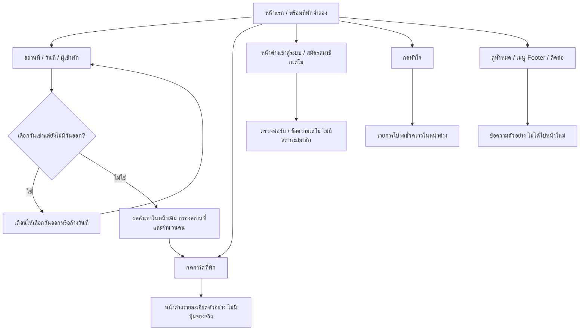
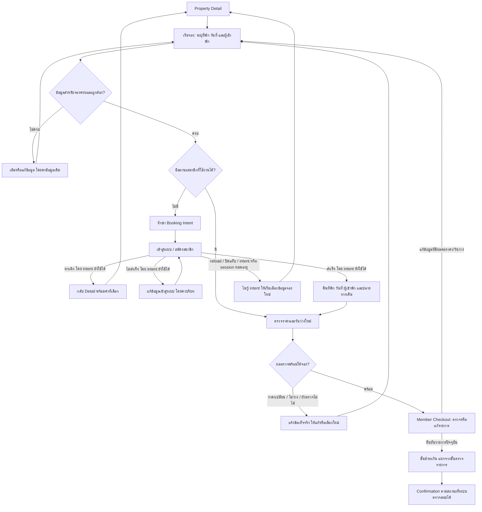

# UXD-001 — แผนผังเส้นทางผู้ใช้

วันที่จัดทำ/ปรับปรุง: 2 พฤศจิกายน 2026 · เขตเวลา Asia/Bangkok · รุ่น: review-2

สถานะ: ภูอนุมัติ UXD-001 review-2 แล้วเมื่อ 2 พฤศจิกายน 2026 (Asia/Bangkok) ตามข้อความ “อนุมัติ UXD-001 review-2” ดู [บันทึกตรวจรับ](../../../tasks/design/UXD-001.md#owner-acceptance) เอกสารนี้ยังไม่ใช่แบบหน้าจอที่อนุมัติ และไม่อนุญาตให้เริ่ม task ถัดไป

review-2 บันทึกคำตอบ Q-01 ถึง Q-05 จากภู: Favorites ต้อง login, ยืนยันทางกลับเมื่อยกเลิก Auth, ไม่กู้ Booking Intent หลัง reload/ปิดแท็บ/หมดอายุ, ยืนยันขอบเขต Footer และใช้จำนวนผู้เข้าพักรวมไม่แยกผู้ใหญ่/เด็กพร้อมสัตว์เลี้ยงแยก ดู [บันทึกข้อสรุป](edge-flows.md#3-ข้อสรุปเฉพาะงานที่ภูยืนยัน)

## 1. ขอบเขตและวิธีอ่าน

สำรวจเส้นทางค้นหา ดูรายละเอียด เข้าสู่ระบบ จอง ตรวจรายการ ชำระเงิน และดูผลรายการ รวมการนำทางของผู้เยี่ยมชม (Guest) และสมาชิก (Member) ตาม [UXD-001](../../../tasks/design/UXD-001.md) โดยไม่เปลี่ยนโครงสร้างหน้าหรือแบรนด์ที่เลือกไว้

ยึด `UXF-003`, `UXF-004`, `UX-001`, `UX-004` ใน [decision registry](../../decisions/registry.yaml) เป็นข้อกำหนดหลัก ใช้ `PAGE-001` ถึง `PAGE-010`, `PAGE-005`, `EXEC-007` และ [ข้อกำหนด UX/UI](../approved-ux-ui-scope.md) ประกอบการอธิบายปลายทางและข้อมูลที่ต้องรักษา

ป้ายกำกับในเอกสาร:

- **ปัจจุบัน:** ตรวจพบในโค้ดหรือ local demo ระบุหลักฐานไว้ใน [ทะเบียนสำรวจ](information-architecture.md#4-หลักฐานการสำรวจ-local-demo)
- **เป้าหมาย:** พฤติกรรมตามข้อกำหนดที่ภูยืนยัน ยังไม่ได้เขียนเป็นระบบจริง
- **ข้อเสนอ:** รายละเอียด UX ที่ภูรับเป็นแนวทางภายในขอบเขตเอกสาร review-2 ที่ตรวจรับแล้ว ไม่ใช่สเปกเทคนิคหรือ final UI
- **รอตัดสินใจ:** ไม่มีข้อสรุปเพียงพอ จึงไม่กำหนดพฤติกรรมหรือค่าทางเทคนิคแทนเจ้าของโครงการ

ไม่รวม wireframe, high-fidelity UI, tokens/CSS, การเขียนโค้ด, schema, API, การเชื่อม Auth/Database/Payment หรือ deployment

## 2. เส้นทางปัจจุบัน

อ้างอิง source commit `b5c65e2` และ local Next.js dev ที่ `http://127.0.0.1:3000/` การสำรวจครั้งนี้ไม่ได้ทดสอบ Workers หรือระบบธุรกิจจริง

ข้อจำกัดที่ตรวจพบ:

- มี application route `/` เท่านั้น รายละเอียด Auth และรายการโปรดเป็นหน้าต่างภายในหน้าแรก
- วันที่และจำนวนสัตว์เลี้ยงมีสถานะในฟอร์ม แต่ `onSearch` ส่งเฉพาะสถานที่กับผลรวมผู้ใหญ่และเด็ก ไม่มีการตรวจวันว่างหรือนโยบายสัตว์เลี้ยง
- ผลค้นหาไม่เปลี่ยน URL; สถานะค้นหา รายการโปรด และคุกกี้เดโมล้างเมื่อ reload
- ยังไม่มี Booking Intent หรือเส้นทางกลับจากการเข้าสู่ระบบไปจอง เพราะยังไม่มีการเข้าสู่ระบบและการจองจริง

## 3. เส้นทางเป้าหมายตามข้อกำหนด

### J-01 — ค้นหาและเลือกที่พักโดยยังไม่เข้าสู่ระบบ

ผู้เยี่ยมชมเปิด Home → ดูรายการได้ทันที → เลือกหมวดจาก 7 หมวด หรือค้นหาด้วยเงื่อนไขที่ต้องการ → Results → ปรับหลายตัวกรองแล้วกด Apply Filters → เปลี่ยนหน้าผลลัพธ์ → Property Detail

วันที่และจำนวนผู้เข้าพักเป็นข้อมูลไม่บังคับสำหรับการดูรายการ การดูรายละเอียดไม่ต้องเข้าสู่ระบบ การแสดงราคาเริ่มต้นไม่ถือเป็นการยืนยันราคาและวันว่างสำหรับการจอง

รักษาสถานที่ หมวด ตัวกรอง และหน้าผลลัพธ์เมื่อย้อนกลับจากรายละเอียด โดย Results เก็บสถานะค้นหา/ตัวกรอง/หน้าไว้ใน URL ตามข้อกำหนด ชื่อ URL และ query parameters ยังไม่ได้กำหนดใน task นี้

### J-02 — ผู้เยี่ยมชมเริ่มจองและกลับมาทำต่อหลังเข้าสู่ระบบ

ลำดับตรวจความครบถ้วนก่อนเปิด Auth ในแผนผังเป็นแนวทาง UX ที่ตรวจรับใน review-2 เพื่อไม่ให้เข้าสู่ระบบแล้วกลับมาพบข้อมูลจองที่ยังไม่ครบ วิธีตรวจ การสำรองที่พัก และกลไกส่งกลับเป็นงานออกแบบ/ระบบภายหลัง ส่วนขอบเขตการรักษา intent ยืนยันแล้วใน Q-03: รักษาเฉพาะการทำงานต่อเนื่องที่ยังไม่ reload ปิดแท็บ หรือหมดอายุ

การเข้าสู่ระบบสำเร็จไม่เท่ากับจองสำเร็จ การกลับจากหน้าผู้ให้บริการชำระเงินก็ไม่ใช่หลักฐานว่าชำระเงินหรือจองสำเร็จ ต้องแสดงสองสถานะตามข้อมูลที่ตรวจสอบได้ ดู `E-13` และ `E-14` ใน [edge-flows.md](edge-flows.md)

### J-03 — สมาชิกเริ่มจอง

สมาชิกใช้ Home/Results/Property Detail ได้เช่นเดียวกับผู้เยี่ยมชม เมื่อเริ่มจองและสถานะสมาชิกยังใช้ได้ ให้เข้าสู่การตรวจราคา/วันว่างและ Member Checkout โดยไม่บังคับกรอกข้อมูลติดต่อที่มีในโปรไฟล์ซ้ำ

การแก้ที่พัก วันที่ หรือผู้เข้าพักต้องนำไปตรวจข้อมูลที่เกี่ยวข้องใหม่ก่อนยืนยันรายการ หาก intent หรือ session หมดอายุ ไม่กู้ intent เดิม ให้แจ้งว่าต้องเริ่มเลือกข้อมูลจองใหม่และเข้าสู่ระบบเมื่อจำเป็น ไม่มีการส่งคำขอชำระเงินซ้ำอัตโนมัติ การล้าง draft intent ไม่ลบรายการจองหรือสถานะชำระเงินที่สร้างจริงแล้ว

### J-04 — ดูรายการโปรด

สมาชิกเปิด Favorites Grid → เลือกที่พัก → Property Detail → เริ่มจองได้โดยใช้กติกาเดียวกับ J-03 ไม่มี Collections หรือ Comparison

ตาม Q-01 ที่ภูยืนยัน การดูและจัดการ Favorites ต้อง login เท่านั้น Guest ที่กดหัวใจหรือเปิด Favorites ต้องผ่าน Auth ก่อนใช้รายการโปรด ไม่บันทึกเป็น Guest favorites ชั่วคราวและไม่มีการรวมรายการ Guest เข้าบัญชี

หลัง login สำเร็จใน flow ที่ต่อเนื่อง ให้กลับจุดที่ต้องการใช้ Favorites; ข้อเสนอให้แสดงที่พักเดิมเพื่อให้กดยืนยันบันทึกอีกครั้ง โดยไม่ถือว่าก่อน login ได้บันทึกแล้ว หากยกเลิก Auth ให้กลับหน้าที่เปิดมาโดยไม่เปลี่ยนรายการโปรด การ browse และเปิด Property Detail ยังไม่ต้อง login

เดโมปัจจุบันยังอนุญาต Guest favorites ชั่วคราวตาม B-03 ซึ่งเป็นข้อแตกต่างจากเป้าหมายที่ยืนยันแล้ว ไม่ได้แก้โค้ดเดโมใน task นี้

### J-05 — ดูรายการจองและผลการทำรายการ

สมาชิกเปิด My Bookings → เลือกแท็บกำลังจะมาถึง/ที่ผ่านมา/ยกเลิก → เปิด Booking Detail/Confirmation ของรายการที่มีสิทธิ์ดู → เห็นสถานะจองและสถานะชำระเงินแยกกัน

ข้อความ Confirmation ต้องสะท้อนข้อมูลจริง รวมกรณียังรอยืนยัน การยกเลิกจอง คืนเงิน แก้ไขจอง และกฎแบ่งแท็บเป็นรายละเอียดโดเมนที่ task นี้ไม่กำหนดขึ้นใหม่ การมีแท็บยกเลิกไม่ใช่การยืนยันว่ามีบริการยกเลิกด้วยตนเอง

### J-06 — การนำทางบัญชีและย้อนกลับ

สมาชิกเข้าถึง Profile, Favorites และ My Bookings ได้ตามโครงสร้างที่เลือกไว้ เมนูและการจัดวางจริงเป็นงานออกแบบถัดไป การออกจากระบบหรือเปิดลิงก์หน้าบัญชีโดยไม่มี session ต้องไม่เปิดเผยข้อมูลบัญชี การเข้าสู่ระบบแบบต่อเนื่องให้กลับหน้าที่ตั้งใจเปิด ส่วน Booking Intent ต้องไม่ถูกกู้หลัง reload/ปิดแท็บ/หมดอายุตาม Q-03

การแก้โปรไฟล์ใช้ Modern Split Profile ที่เลือกไว้ ไม่เพิ่ม account dashboard หรือระบบผู้ลงประกาศจากปุ่มเดโมเดิม

## 4. ข้อมูลที่ต้องรักษาระหว่างเส้นทาง

| ข้อมูล | จุดที่ใช้ | ข้อกำหนด/ข้อเสนอและข้อจำกัด |
|---|---|---|
| Property ID | Detail → Auth → Checkout | ข้อกำหนดหลัก ต้องอ้างถึงที่พักเดิม ไม่ใช้ชื่อหรือรูปแทนรหัส |
| วันเข้า–วันออก | ค้นหา/Detail → Auth → Checkout | การดูรายการปล่อยว่างได้; การจองต้องครบและตรวจใหม่ |
| ผู้เข้าพักและสัตว์เลี้ยง | ค้นหา/Detail → Auth → Checkout | ตาม Q-05 ใช้จำนวนผู้เข้าพักรวม ไม่แยกผู้ใหญ่/เด็ก และมีสัตว์เลี้ยงแยกจากจำนวนคน; คงค่าที่เลือกใน flow ต่อเนื่อง กฎความจุ/สัตว์เลี้ยงจริงยังต้องตรวจ |
| สถานที่ หมวด ตัวกรอง หน้า | Results ↔ Detail | คงสถานะ Results ใน URL; รายการ query และรูปแบบ routing เป็นงานภายหลัง |
| หน้าต้นทาง/ปลายทางที่ตั้งใจเปิด | Auth และการย้อนกลับ | ข้อเสนอให้ใช้บริบทนำทางภายในเว็บ ไม่รับปลายทางภายนอกโดยไม่ตรวจสอบ |
| ราคาและวันว่างที่เคยเห็น | Detail → Checkout | เป็นบริบทสำหรับแจ้งการเปลี่ยนแปลง ไม่ใช้แทนผลตรวจล่าสุด |
| ข้อมูลติดต่อสมาชิก | Profile → Checkout | ใช้ข้อมูลจากบัญชีที่ยืนยันแล้ว; ถ้าขาดข้อมูลให้แจ้งสิ่งที่ต้องเติมโดยไม่กรอกซ้ำโดยไม่จำเป็น |

Booking Intent ไม่รวมรหัสผ่าน ข้อมูลชำระเงิน หรือ session credentials ตาม Q-03 จะไม่กู้ intent หลัง reload/ปิดแท็บ/intent หรือ session หมดอายุ ต้องเลือกข้อมูลจองใหม่ ไม่เพิ่มการกู้ข้ามแท็บ วิธีจัดการสถานะชั่วคราวเป็นงานภายหลังและไม่มีการสร้าง storage จริงใน UXD-001

สถานะค้นหาใน URL ของ Results เป็นคนละเรื่องกับ Booking Intent จึงยังอ่านเงื่อนไขค้นหาจาก URL ได้ตามข้อกำหนดเดิม แต่ห้ามใช้เป็นการกู้ draft booking อัตโนมัติหลังเหตุที่ Q-03 ระบุ การเข้าดูรายการจองที่สร้างจริงแล้วหลัง login เป็นการอ่านรายการเดิม ไม่ใช่การกู้ intent

## 5. การเชื่อมข้อกำหนดและเกณฑ์ตรวจรับ

| เกณฑ์ | ข้อกำหนด | จุดตรวจในเอกสาร | หลักฐาน/ข้อจำกัด |
|---|---|---|---|
| AC-01 ดูและค้นหาได้โดยไม่มีวันที่หรือ login | UX-001 | J-01, IA-01 ถึง IA-03, E-01 | ปัจจุบันตรวจ local demo ได้ทั้ง Desktop/Mobile; เส้นทางหลายหน้าเป้าหมายยังไม่สร้าง |
| AC-02 การจองต้อง login และรักษา intent ใน flow ต่อเนื่อง | UX-004, UXF-004, PAGE-005, EXEC-007, Q-03 | J-02/J-03, ตารางข้อมูล, E-06 ถึง E-10/E-15 | ไม่กู้ intent หลัง reload/ปิดแท็บ/หมดอายุ; ยังไม่ใช่ผลทดสอบ Auth หรือ Booking จริง |
| AC-03 สะท้อนหน้าแรก เมนู และรายการหน้าที่มีอยู่ | UXF-003 | แผนผังปัจจุบัน, IA-01 ถึง IA-10 และทะเบียนเมนู | ตรวจ route source และตัวอย่าง local; หน้าสมาชิกและจองยังไม่มี |

ภูตรวจรับเอกสาร review-2 ทั้งชุดแล้วตามบันทึกตรวจรับข้างต้น ข้อสรุป Q-01 ถึง Q-05 คงเดิม การอนุมัติเอกสารนี้ไม่ใช่การอนุมัติ wireframe, final UI หรือการเริ่มงานต่ออัตโนมัติ

อ่านต่อ: [รายการหน้าและหลักฐาน](information-architecture.md) · [ทางแยกและข้อสรุปเฉพาะงาน](edge-flows.md)
