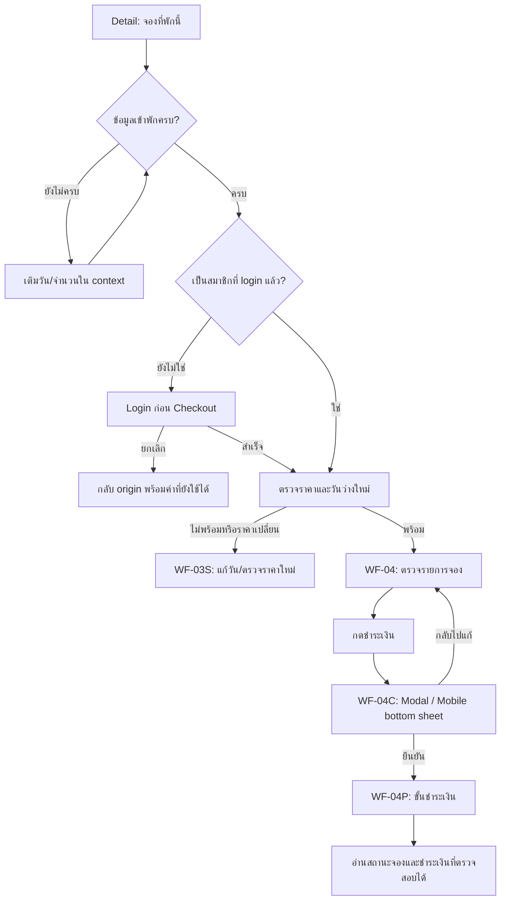

# UXD-002 — review-5

วันที่ 3 พฤศจิกายน 2026 (Asia/Bangkok) · **รอเจ้าของตรวจรับแบบ**

ปรับจาก rebuilt-1 ตามคำตอบเจ้าของ Q-01–Q-12 และ F-01 ใน [review-decisions](../review-decisions.md) ใช้หน้าตรวจรายการแบบ Airbnb โดยคงกฎ paipak ให้ Guest เข้าสู่ระบบก่อน Member Checkout ไม่คัดลอกตำแหน่ง Auth บริการผ่อนชำระ นโยบาย หรือข้อมูลที่พักของ reference มาเป็นความสามารถของ paipak

## ไฟล์ต้นฉบับและสเปก

- **Desktop + Mobile ครบ 8 กลุ่มต่อขนาด:** [เปิดภาพคู่และจุดต่าง Desktop/Mobile](flow-groups/desktop/README.md) · [ดัชนี Desktop](flow-groups/desktop/index.png) · [ดัชนี Mobile](flow-groups/index.png) · [Editable snapshot ล่าสุด 21 major containers](flow-groups/desktop/editable-snapshot.json)
- **ทบทวนครบ 8 กลุ่ม:** เริ่มที่ `FLOW-REVIEW — INDEX · 8 user tasks` ทางขวาของ canvas แล้วเปิด `FLOW-REVIEW F-01` ถึง `F-08` แต่ละกลุ่มมีเส้นทางหลัก ทางแยก ย้อนกลับ/ยกเลิก จุดทบทวน และประเด็นเปิด [เปิดชุดทบทวนและรูปครบทุกกลุ่ม](flow-groups/README.md) · [ภาพดัชนี](flow-groups/index.png)
- **Snapshot ก่อนเพิ่ม Desktop:** [flow-groups/editable-snapshot.json](flow-groups/editable-snapshot.json) — 12 major containers ของรอบ Mobile; ล่าสุดทั้งสองขนาดอยู่ใน flow-groups/desktop/editable-snapshot.json โดยหน้าจอจริงยัง 40 ภาพและแผงหมายเหตุเดิม 40 แผง
- **User flow บน canvas:** เริ่มที่กรอบ `USER-FLOW — START HERE` แล้วดูหน้าจอจริงใน `FLOW-DESKTOP` และ `FLOW-MOBILE` ซึ่งเรียงตามเส้นทางและเชื่อมลูกศรแล้ว รวม 40 หน้าจอ + 40 แผงหมายเหตุเดิม ไม่เพิ่ม template หรือ route
- [ภาพรวม user flow](user-flow-overview.png) · [Snapshot ก่อนเพิ่ม 8 review groups](editable-flow-snapshot.json) · [ตำแหน่งและชั้นลูกศรของ 3 flow boards เดิม](canvas-user-flow.json)
- [Pencil source](../paipak-wireframe.pen) — จัด flow ใน canvas ที่เปิดไฟล์นี้แล้ว; เจ้าของจะบันทึกเองเมื่อพร้อม การบันทึก native ของ layout ล่าสุดยังไม่ยืนยันจากดิสก์ ใช้ flow-groups/desktop/editable-snapshot.json เป็นสำเนาล่าสุดระหว่างรอบันทึก
- [Editable layer snapshot ก่อนจัด flow](editable-snapshot.json) — เก็บเนื้อหา 40 screen frames + 40 annotation frames เดิม; hierarchy ล่าสุดอยู่ใน flow-groups/editable-snapshot.json สำเนา public layer schema ไม่ใช่ไฟล์ .pen
- [Export index](export-index.json) — frame IDs และขนาด PNG ทั้ง 40 ไฟล์
- [Component inventory / states / acceptance](component-inventory.md)
- [User flow ครบเส้นทางหลักและทางแยก](user-flow.md)
- [Interaction specification](../interaction-specification.md) และ [UX requirements](../ux-requirements.md) รุ่น review-5
- [ชุด rebuilt-1 เดิม](../rebuilt-1/README.md) คงไว้เป็นประวัติ; ไม่ใช่ชุดล่าสุด

## Flow ที่ยืนยันแล้ว

การนำทาง/Auth ต่อเนื่องเท่านั้นที่รักษา Booking Intent; reload/ปิดแท็บ/intent หรือ session หมดอายุต้องเริ่มข้อมูลจองใหม่ตาม UXD-001 Q-03 ไม่กู้จาก storage และไม่ส่งคำขอชำระเงินซ้ำอัตโนมัติ

## ภาพสำหรับรีวิว

รวม **Desktop 18 ภาพที่ 1440px / Mobile 22 ภาพที่ 390px**: 18 main-page frames และ 22 supporting/state frames ครอบคลุม 10 templates เดิม สถานะเพิ่มไม่ใช่ route ใหม่และไม่เริ่ม task ใหม่

| Screen | Desktop | Mobile |
|---|---|---|
| WF-01 Home | [ภาพ](desktop/wf-01.png) | [ภาพ](mobile/wf-01.png) |
| WF-01N Mobile navigation | — | [ภาพ](mobile/wf-01n.png) |
| WF-02 Search Results | [ภาพ](desktop/wf-02.png) | [ภาพ](mobile/wf-02.png) |
| WF-02A Location autocomplete | [ภาพ](desktop/wf-02a.png) | [ภาพ](mobile/wf-02a.png) |
| WF-02F Mobile filter drawer | — | [ภาพ](mobile/wf-02f.png) |
| WF-02P Search date and guest pickers | [ภาพ](desktop/wf-02p.png) | [ภาพ](mobile/wf-02p.png) |
| WF-03 Property detail | [ภาพ](desktop/wf-03.png) | [ภาพ](mobile/wf-03.png) |
| WF-03V Mobile detail viewport | — | [ภาพ](mobile/wf-03v.png) |
| WF-03D Mobile date editor | — | [ภาพ](mobile/wf-03d.png) |
| WF-03S Availability and quote states | [ภาพ](desktop/wf-03s.png) | [ภาพ](mobile/wf-03s.png) |
| WF-04 Member booking review | [ภาพ](desktop/wf-04.png) | [ภาพ](mobile/wf-04.png) |
| WF-04C Confirm before payment | [ภาพ](desktop/wf-04c.png) | [ภาพ](mobile/wf-04c.png) |
| WF-04P Payment step | [ภาพ](desktop/wf-04p.png) | [ภาพ](mobile/wf-04p.png) |
| WF-05 Login | [ภาพ](desktop/wf-05.png) | [ภาพ](mobile/wf-05.png) |
| WF-05R Register | [ภาพ](desktop/wf-05r.png) | [ภาพ](mobile/wf-05r.png) |
| WF-06 My bookings | [ภาพ](desktop/wf-06.png) | [ภาพ](mobile/wf-06.png) |
| WF-07 Booking detail and confirmation | [ภาพ](desktop/wf-07.png) | [ภาพ](mobile/wf-07.png) |
| WF-08 Favorites | [ภาพ](desktop/wf-08.png) | [ภาพ](mobile/wf-08.png) |
| WF-09 Member profile | [ภาพ](desktop/wf-09.png) | [ภาพ](mobile/wf-09.png) |
| WF-10 Contextual states | [ภาพ](desktop/wf-10.png) | [ภาพ](mobile/wf-10.png) |
| WF-10F Inline form validation states | [ภาพ](desktop/wf-10f.png) | [ภาพ](mobile/wf-10f.png) |
| WF-10I Carousel edge and image states | [ภาพ](desktop/wf-10i.png) | [ภาพ](mobile/wf-10i.png) |

## การเปลี่ยนรอบนี้

- Location autocomplete พร้อม open/selected/no-suggestions states และ affordance ของ date/guest fields
- ห้องนอนใช้ช่วงต่ำสุด–สูงสุดแบบ −/+ แยกสองค่า; Apply Filters ชัดและปิด drawer ทิ้ง unapplied edits
- ปุ่มหลัก Detail และแถบล่างใช้ “จองที่พักนี้”; ราคา/แก้วันเป็นจุดกดแยก; เพิ่มภาพ viewport 390×844 และ date editor เกือบเต็มจอ
- Member Review แสดงข้อมูลที่พัก วัน คน/pets ข้อมูลสมาชิก และยอดรวมก่อน action; ชำระเงินเปิด dialog ยืนยันก่อน Payment step
- Form states แสดง email error, password mismatch, save error และช่วงวันไม่ครบใน context; timing ตาม Client ขณะพิมพ์ + Server ตอนส่ง โดยยังไม่ implement ระบบจริง
- Carousel ไม่ autoplay/ไม่วนขอบสุดท้าย, next disabled เมื่อรูปสุดท้าย, รูปเดียวไม่มี controls และ failed image มี icon+ข้อความไม่มี Retry
- Favorites เอาออกทันที ไม่มี confirm/Undo และจำนวนบน Mobile ตรงกับ 2 การ์ดตัวอย่าง
- Annotation 40 แผงอยู่นอก UI พร้อม Component IDs, entry/exit, state และ acceptance; Designer proposals/domain deferrals แยกใน inventory

## หลักฐานและข้อจำกัด

- จัด flow ภายใน Pencil จริง แยก Desktop/Mobile พร้อมทางข้าม Auth ของสมาชิก การยกเลิก Auth การตรวจราคา/วันว่าง และหน้าประกอบ; ลูกศรเป็นคำอธิบายภาพนิ่ง ยังไม่ใช่ click-through prototype
- ตรวจเส้นลูกศรไม่ตัดผ่านกรอบ UI/หมายเหตุ และย้ายป้ายที่ทับกันออก; ภาพ PNG หน้าจอเดิม 40 ภาพยังใช้ได้เพราะไม่ได้แก้เนื้อหา UI ในรอบจัด flow
- ตรวจภาพนิ่งของส่วนที่เปลี่ยนและ state ใหม่ผ่าน Pencil screenshots และ PNG exports; ตรวจขนาด PNG ทั้ง 40 ไฟล์เทียบกับ frame index
- มี viewport states 390×844 สำหรับ sticky CTA, near-fullscreen date editor และ confirmation bottom sheet; full-page images อื่นไม่ถือว่าเป็นผลทดสอบ scroll/sticky จริง
- จำนวน controls/dots ตรวจจาก layer snapshot; ภาพหลักมี 22 listing carousels พร้อม 110 photo dots และเพิ่ม state sheet แยก ไม่บังคับทุกที่พักมี 5 รูป
- ตรวจ geometry ของ root frames/annotation ว่าไม่ซ้อนกัน; descendant clipping diagnostics ของ Pencil บางรายการไม่ตรงกับภาพที่ render จึงไม่ใช้เป็นหลักฐานอัตโนมัติว่า overflow ผ่านทั้งหมด อาศัย visual review ของภาพในขอบเขตนี้
- ตรวจ labels และข้อความ error ที่ไม่ใช้สีอย่างเดียว และบันทึก focus/keyboard rules; ยังไม่ได้ทดสอบ keyboard, screen reader, text zoom, 320px, Tablet image หรือ touch targets ในระบบจริง
- วันที่ ราคา พื้นที่ จำนวนห้อง คน/pets และ contact เป็น sample; ไม่ใช่ availability, quote, capacity หรือข้อมูลบัญชีจริง
- OPEN-001 ถึง OPEN-007 ยังมีผล รวม contrast final CTA, provider contract, hold/catalog authority และ production runtime; ไม่คัดลอก Klarna หรือบริการชำระเงินจาก reference
- ไม่มี application/dependency/backend/cloud/deployment changes; ไม่รัน Next.js build หรือ Workers suite สำหรับการแก้เอกสารและ wireframe นี้

**การยืนยันคำตอบและการกดบันทึกไม่ใช่การอนุมัติแบบสุดท้าย** โปรดตรวจภาพและ Interaction Specification รุ่น review-5 ก่อนอนุมัติ dependent frontend work
