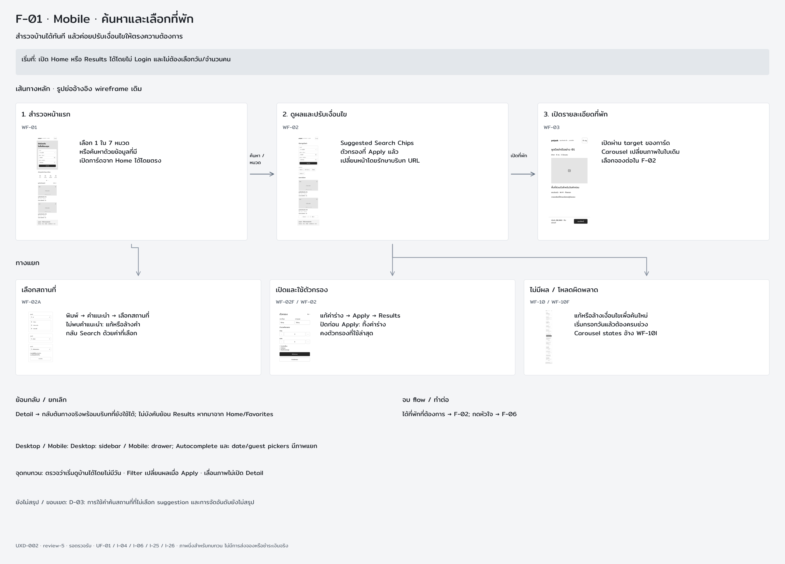
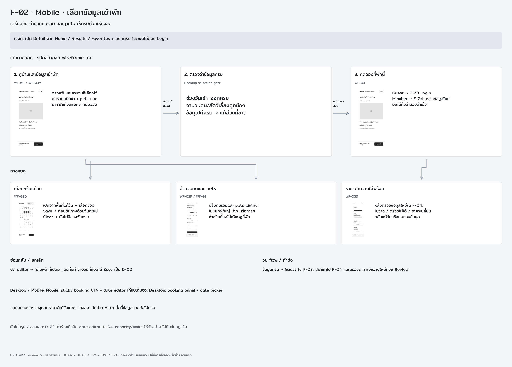
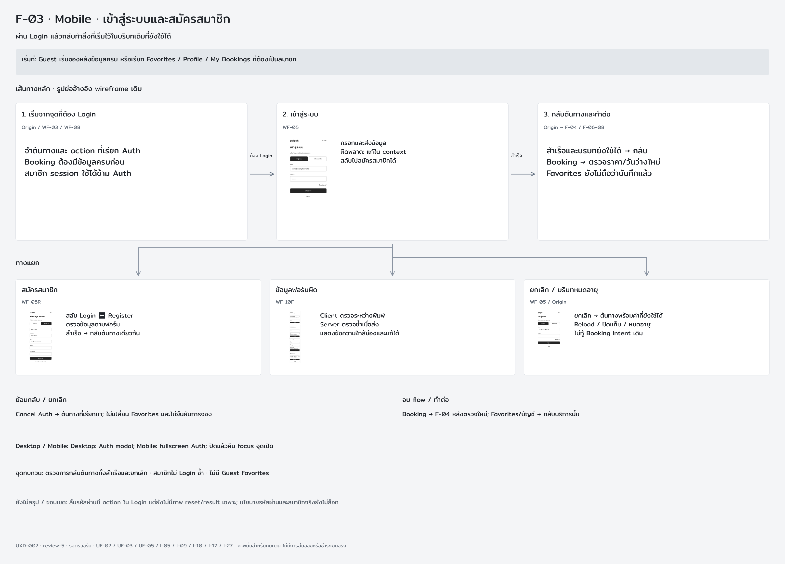
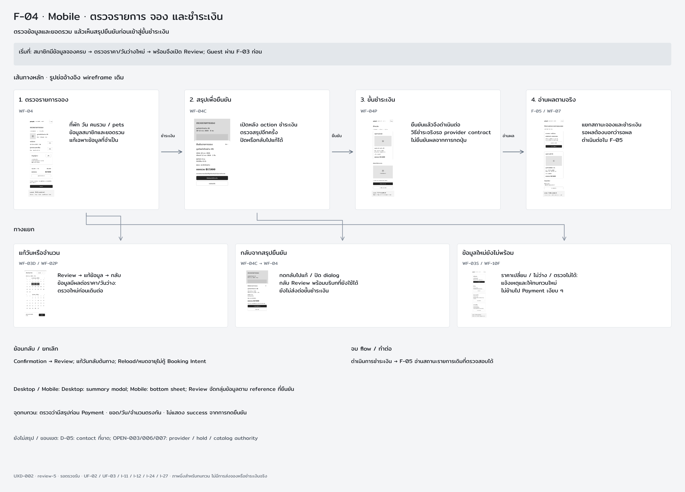
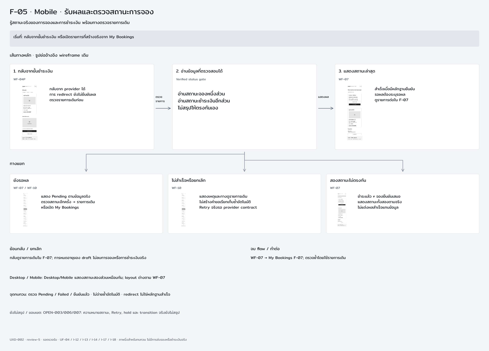
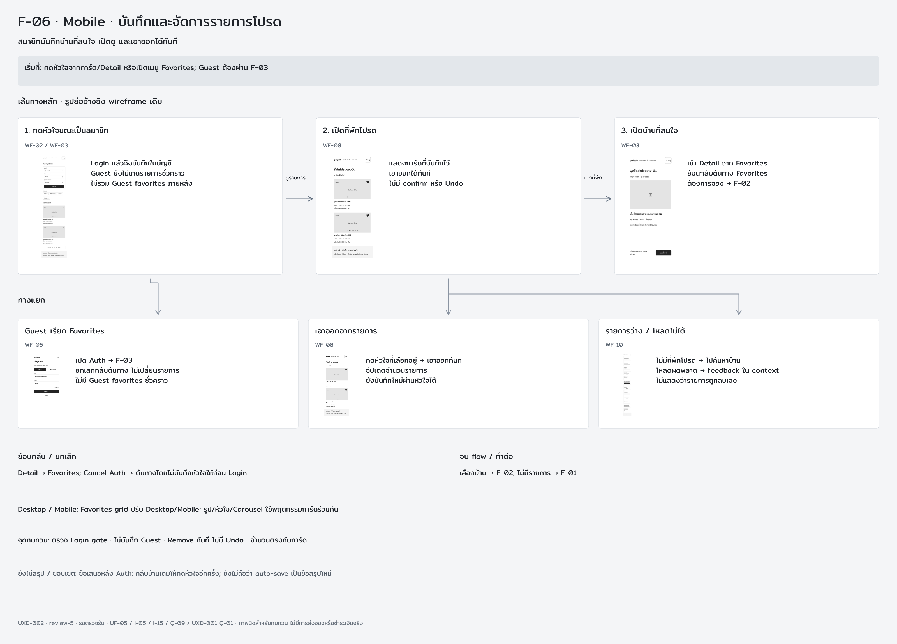
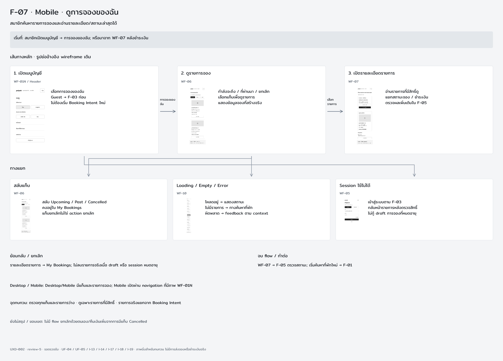
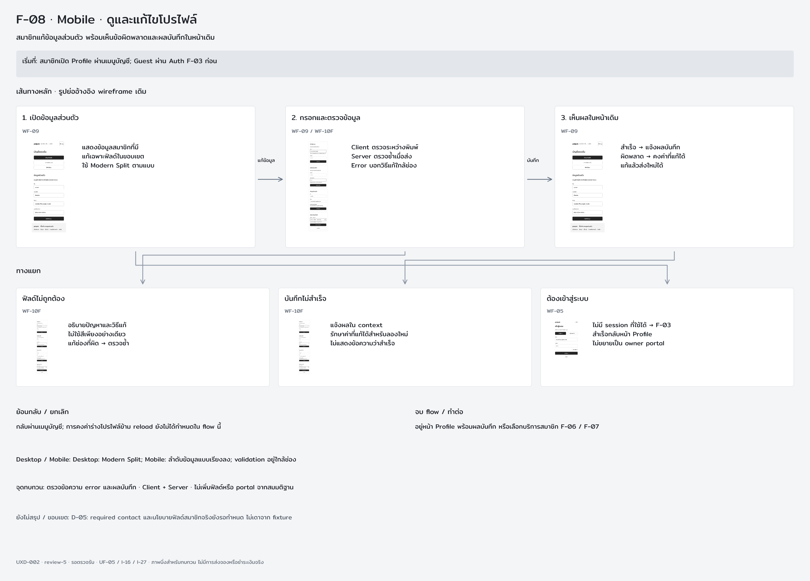

# UXD-002 review-5 — ทบทวน User Flow ครบ 8 กลุ่ม

**มีครบ Desktop และ Mobile แล้ว:** [Desktop 8 กลุ่มพร้อมภาพเทียบ Mobile](desktop/README.md) · [ดัชนี Desktop](desktop/index.png) · [ดัชนี Mobile](index.png) · [สำเนาชั้นล่าสุดทั้ง canvas](desktop/editable-snapshot.json) ภาพในหน้านี้เป็นชุด Mobile

3 พฤศจิกายน 2026 (Asia/Bangkok) · รอเจ้าของตรวจรับแบบ

จัดภายใน Pencil canvas: ชุด Mobile เริ่มที่ `FLOW-REVIEW — INDEX · MOBILE · 8 user tasks` และกรอบ `FLOW-REVIEW F-01` ถึง `F-08` ที่มีป้าย Mobile; ชุด Desktop อยู่ใน index และกรอบ `FLOW-REVIEW DESKTOP F-01` ถึง `F-08` ทางขวาถัดไป แต่ละชุดมีหน้าจออ้างอิง เส้นทางหลัก ทางแยก ทางกลับ จุดทบทวน และประเด็นเปิด เนื้อหา UI ที่แก้ไขได้ยังอยู่ในกรอบ WF-* เดิม 40 หน้าจอ

[ภาพดัชนี Mobile](index.png) · [Snapshot ก่อนเพิ่ม Desktop](editable-snapshot.json) · [Mobile export index](flow-index.json) · [Interaction specification](../../interaction-specification.md) · [Review pack](../README.md)

ภาพกลุ่มเป็น annotation สำหรับทบทวน ไม่ใช่ route ใหม่หรือ prototype ที่กดทำรายการได้; ไม่เปลี่ยน UXD-001 และไม่เพิ่ม backend/payment integration เจ้าของเลือกบันทึก native file เองเมื่อพร้อม ไม่ร้องขอ Ctrl+S ซ้ำและไม่ใช้ Computer Use

## ดัชนี

| กลุ่ม | ภาพ | เป้าหมาย |
|---|---|---|
| F-01 ค้นหาและเลือกที่พัก | [เปิดภาพ](f-01.png) | สำรวจบ้านได้ทันที แล้วค่อยปรับเงื่อนไขให้ตรงความต้องการ |
| F-02 เลือกข้อมูลเข้าพัก | [เปิดภาพ](f-02.png) | เตรียมวัน จำนวนคนรวม และ pets ให้ครบก่อนเริ่มจอง |
| F-03 เข้าสู่ระบบและสมัครสมาชิก | [เปิดภาพ](f-03.png) | ผ่าน Login แล้วกลับทำสิ่งที่เริ่มไว้ในบริบทเดิมที่ยังใช้ได้ |
| F-04 ตรวจรายการ จอง และชำระเงิน | [เปิดภาพ](f-04.png) | ตรวจข้อมูลและยอดรวม แล้วเห็นสรุปยืนยันก่อนเข้าสู่ขั้นชำระเงิน |
| F-05 รับผลและตรวจสถานะการจอง | [เปิดภาพ](f-05.png) | รู้สถานะจริงของการจองและการชำระเงิน พร้อมทางตรวจรายการเดิม |
| F-06 บันทึกและจัดการรายการโปรด | [เปิดภาพ](f-06.png) | สมาชิกบันทึกบ้านที่สนใจ เปิดดู และเอาออกได้ทันที |
| F-07 ดูการจองของฉัน | [เปิดภาพ](f-07.png) | สมาชิกค้นหารายการจองและอ่านรายละเอียด/สถานะล่าสุดได้ |
| F-08 ดูและแก้ไขโปรไฟล์ | [เปิดภาพ](f-08.png) | สมาชิกแก้ข้อมูลส่วนตัว พร้อมเห็นข้อผิดพลาดและผลบันทึกในหน้าเดิม |

## F-01 — ค้นหาและเลือกที่พัก

**เป้าหมาย:** สำรวจบ้านได้ทันที แล้วค่อยปรับเงื่อนไขให้ตรงความต้องการ

**เริ่มที่:** เปิด Home หรือ Results ได้โดยไม่ Login และไม่ต้องเลือกวัน/จำนวนคน

**เส้นทางหลัก:** สำรวจหน้าแรก (WF-01) → ดูผลและปรับเงื่อนไข (WF-02) → เปิดรายละเอียดที่พัก (WF-03)

ทางแยก:

- **เลือกสถานที่ (WF-02A):** พิมพ์ → คำแนะนำ → เลือกสถานที่; ไม่พบคำแนะนำ: แก้หรือล้างคำ; กลับ Search ด้วยค่าที่เลือก
- **เปิดและใช้ตัวกรอง (WF-02F / WF-02):** แก้ค่าร่าง → Apply → Results; ปิดก่อน Apply: ทิ้งค่าร่าง; คงตัวกรองที่ใช้ล่าสุด
- **ไม่มีผล / โหลดผิดพลาด (WF-10 / WF-10F):** แก้หรือล้างเงื่อนไขเพื่อค้นใหม่; เริ่มกรอกวันแล้วต้องครบช่วง; Carousel states อ้าง WF-10I

**ย้อนกลับ/ยกเลิก:** Detail → กลับต้นทางจริงพร้อมบริบทที่ยังใช้ได้; ไม่บังคับย้อน Results หากมาจาก Home/Favorites

**จบ flow/ทำต่อ:** ได้ที่พักที่ต้องการ → F-02; กดหัวใจ → F-06

**Desktop/Mobile:** Desktop: sidebar / Mobile: drawer; Autocomplete และ date/guest pickers มีภาพแยก

**จุดทบทวน:** ตรวจว่าเริ่มดูบ้านได้โดยไม่มีวัน · Filter เปลี่ยนผลเมื่อ Apply · เลื่อนภาพไม่เปิด Detail

**ยังไม่สรุป/ขอบเขต:** D-03: การใช้คำค้นสถานที่ที่ไม่เลือก suggestion และการจัดอันดับยังไม่สรุป

อ้างอิงเดิม: UF-01, I-04, I-06, I-25, I-26

## F-02 — เลือกข้อมูลเข้าพัก

**เป้าหมาย:** เตรียมวัน จำนวนคนรวม และ pets ให้ครบก่อนเริ่มจอง

**เริ่มที่:** เปิด Detail จาก Home / Results / Favorites / ลิงก์ตรง โดยยังไม่ต้อง Login

**เส้นทางหลัก:** ดูบ้านและข้อมูลเข้าพัก (WF-03 / WF-03V) → ตรวจว่าข้อมูลครบ (Booking selection gate) → กดจองที่พักนี้ (WF-03)

ทางแยก:

- **เลือกหรือแก้วัน (WF-03D):** เปิดจากพื้นที่แก้วัน → เลือกช่วง; Save → กลับต้นทางด้วยวันที่ใหม่; Clear → ยังไม่มีช่วงวันครบ
- **จำนวนคนและ pets (WF-02P / WF-03):** ปรับคนรวมและ pets แยกกัน; ไม่แยกผู้ใหญ่ เด็ก หรือทารก; ค่าจริงต้องไม่เกินกฎที่พัก
- **ราคา/วันว่างไม่พร้อม (WF-03S):** หลังตรวจข้อมูลใหม่ใน F-04:; ไม่ว่าง / ตรวจไม่ได้ / ราคาเปลี่ยน; กลับแก้วันหรือทบทวนข้อมูล

**ย้อนกลับ/ยกเลิก:** ปิด editor → กลับหน้าที่เปิดมา; วิธีทิ้งค่าร่างวันที่ที่ยังไม่ Save เป็น D-02

**จบ flow/ทำต่อ:** ข้อมูลครบ → Guest ไป F-03; สมาชิกไป F-04 และตรวจราคา/วันว่างใหม่ก่อน Review

**Desktop/Mobile:** Mobile: sticky booking CTA + date editor เกือบเต็มจอ; Desktop: booking panel + date picker

**จุดทบทวน:** ตรวจจุดกดราคา/แก้วันแยกจากจอง · ไม่เปิด Auth ทั้งที่ข้อมูลจองยังไม่ครบ

**ยังไม่สรุป/ขอบเขต:** D-02: ค่าร่างเมื่อปิด date editor; D-04: capacity/limits ใช้ตัวอย่าง ไม่ยืนยันกฎจริง

อ้างอิงเดิม: UF-02, UF-03, I-01, I-08, I-24

## F-03 — เข้าสู่ระบบและสมัครสมาชิก

**เป้าหมาย:** ผ่าน Login แล้วกลับทำสิ่งที่เริ่มไว้ในบริบทเดิมที่ยังใช้ได้

**เริ่มที่:** Guest เริ่มจองหลังข้อมูลครบ หรือเรียก Favorites / Profile / My Bookings ที่ต้องเป็นสมาชิก

**เส้นทางหลัก:** เริ่มจากจุดที่ต้อง Login (Origin / WF-03 / WF-08) → เข้าสู่ระบบ (WF-05) → กลับต้นทางและทำต่อ (Origin → F-04 / F-06–08)

ทางแยก:

- **สมัครสมาชิก (WF-05R):** สลับ Login ↔ Register; ตรวจข้อมูลตามฟอร์ม; สำเร็จ → กลับต้นทางเดียวกัน
- **ข้อมูลฟอร์มผิด (WF-10F):** Client ตรวจระหว่างพิมพ์; Server ตรวจซ้ำเมื่อส่ง; แสดงข้อความใกล้ช่องและแก้ได้
- **ยกเลิก / บริบทหมดอายุ (WF-05 / Origin):** ยกเลิก → ต้นทางพร้อมค่าที่ยังใช้ได้; Reload / ปิดแท็บ / หมดอายุ:; ไม่กู้ Booking Intent เดิม

**ย้อนกลับ/ยกเลิก:** Cancel Auth → ต้นทางที่เรียกมา; ไม่เปลี่ยน Favorites และไม่ยืนยันการจอง

**จบ flow/ทำต่อ:** Booking → F-04 หลังตรวจใหม่; Favorites/บัญชี → กลับบริการนั้น

**Desktop/Mobile:** Desktop: Auth modal; Mobile: fullscreen Auth; ปิดแล้วคืน focus จุดเปิด

**จุดทบทวน:** ตรวจการกลับต้นทางทั้งสำเร็จและยกเลิก · สมาชิกไม่ Login ซ้ำ · ไม่มี Guest Favorites

**ยังไม่สรุป/ขอบเขต:** ลืมรหัสผ่านมี action ใน Login แต่ยังไม่มีภาพ reset/result เฉพาะ; นโยบายรหัสผ่านและสมาชิกจริงยังไม่ล็อก

อ้างอิงเดิม: UF-02, UF-03, UF-05, I-05, I-09, I-10, I-17, I-27

## F-04 — ตรวจรายการ จอง และชำระเงิน

**เป้าหมาย:** ตรวจข้อมูลและยอดรวม แล้วเห็นสรุปยืนยันก่อนเข้าสู่ขั้นชำระเงิน

**เริ่มที่:** สมาชิกมีข้อมูลจองครบ → ตรวจราคา/วันว่างใหม่ → พร้อมจึงเปิด Review; Guest ผ่าน F-03 ก่อน

**เส้นทางหลัก:** ตรวจรายการจอง (WF-04) → สรุปเพื่อยืนยัน (WF-04C) → ขั้นชำระเงิน (WF-04P) → อ่านผลตามจริง (F-05 / WF-07)

ทางแยก:

- **แก้วันหรือจำนวน (WF-03D / WF-02P):** Review → แก้ข้อมูล → กลับ; ข้อมูลมีผลต่อราคา/วันว่าง:; ตรวจใหม่ก่อนเดินต่อ
- **กลับจากสรุปยืนยัน (WF-04C → WF-04):** กดกลับไปแก้ / ปิด dialog; กลับ Review พร้อมบริบทที่ยังใช้ได้; ยังไม่ส่งต่อขั้นชำระเงิน
- **ข้อมูลใหม่ยังไม่พร้อม (WF-03S / WF-10F):** ราคาเปลี่ยน / ไม่ว่าง / ตรวจไม่ได้:; แจ้งเหตุและให้ทบทวนใหม่; ไม่ข้ามไป Payment เงียบ ๆ

**ย้อนกลับ/ยกเลิก:** Confirmation → Review; แก้วันกลับต้นทาง; Reload/หมดอายุไม่กู้ Booking Intent

**จบ flow/ทำต่อ:** ดำเนินการชำระเงิน → F-05 อ่านสถานะรายการเดิมที่ตรวจสอบได้

**Desktop/Mobile:** Desktop: summary modal; Mobile: bottom sheet; Review จัดกลุ่มข้อมูลตาม reference ที่ยืนยัน

**จุดทบทวน:** ตรวจว่ามีสรุปก่อน Payment · ยอด/วัน/จำนวนตรงกัน · ไม่แสดง success จากการกดยืนยัน

**ยังไม่สรุป/ขอบเขต:** D-05: contact ที่ขาด; OPEN-003/006/007: provider / hold / catalog authority

อ้างอิงเดิม: UF-02, UF-03, I-11, I-12, I-24, I-27

## F-05 — รับผลและตรวจสถานะการจอง

**เป้าหมาย:** รู้สถานะจริงของการจองและการชำระเงิน พร้อมทางตรวจรายการเดิม

**เริ่มที่:** กลับจากขั้นชำระเงิน หรือเปิดรายการที่สร้างจริงจาก My Bookings

**เส้นทางหลัก:** กลับจากขั้นชำระเงิน (WF-04P) → อ่านข้อมูลที่ตรวจสอบได้ (Verified status gate) → แสดงสถานะล่าสุด (WF-07)

ทางแยก:

- **ยังรอผล (WF-07 / WF-10):** แสดง Pending ตามข้อมูลจริง; ตรวจสถานะอีกครั้ง → รายการเดิม; หรือเปิด My Bookings
- **ไม่สำเร็จหรือยกเลิก (WF-10):** แสดงเหตุและทางดูรายการเดิม; ไม่สร้างคำขอเรียกเก็บซ้ำอัตโนมัติ; Retry จริงรอ provider contract
- **สองสถานะไม่ตรงกัน (WF-07):** ชำระแล้ว ≠ จองยืนยันเสมอ; แสดงสถานะทั้งสองตามจริง; ไม่แต่งผลสำเร็จแทนข้อมูล

**ย้อนกลับ/ยกเลิก:** กลับดูรายการเดิมใน F-07; การหมดอายุของ draft ไม่ลบการจองหรือการชำระเงินจริง

**จบ flow/ทำต่อ:** WF-07 → My Bookings F-07; ตรวจซ้ำโดยใช้รายการเดิม

**Desktop/Mobile:** Desktop/Mobile แสดงสถานะสองส่วนเหมือนกัน; layout ต่างตาม WF-07

**จุดทบทวน:** ตรวจ Pending / Failed / ยืนยันแล้ว · ไม่จ่ายซ้ำอัตโนมัติ · redirect ไม่ใช่หลักฐานสำเร็จ

**ยังไม่สรุป/ขอบเขต:** OPEN-003/006/007: ความหมายสถานะ, Retry, hold และ transition จริงยังไม่สรุป

อ้างอิงเดิม: UF-04, I-12, I-13, I-14, I-17, I-18

## F-06 — บันทึกและจัดการรายการโปรด

**เป้าหมาย:** สมาชิกบันทึกบ้านที่สนใจ เปิดดู และเอาออกได้ทันที

**เริ่มที่:** กดหัวใจจากการ์ด/Detail หรือเปิดเมนู Favorites; Guest ต้องผ่าน F-03

**เส้นทางหลัก:** กดหัวใจขณะเป็นสมาชิก (WF-02 / WF-03) → เปิดที่พักโปรด (WF-08) → เปิดบ้านที่สนใจ (WF-03)

ทางแยก:

- **Guest เรียก Favorites (WF-05):** เปิด Auth → F-03; ยกเลิกกลับต้นทาง ไม่เปลี่ยนรายการ; ไม่มี Guest favorites ชั่วคราว
- **เอาออกจากรายการ (WF-08):** กดหัวใจที่เลือกอยู่ → เอาออกทันที; อัปเดตจำนวนรายการ; ยังบันทึกใหม่ผ่านหัวใจได้
- **รายการว่าง / โหลดไม่ได้ (WF-10):** ไม่มีที่พักโปรด → ไปค้นหาบ้าน; โหลดผิดพลาด → feedback ใน context; ไม่แสดงว่ารายการถูกลบเอง

**ย้อนกลับ/ยกเลิก:** Detail → Favorites; Cancel Auth → ต้นทางโดยไม่บันทึกหัวใจให้ก่อน Login

**จบ flow/ทำต่อ:** เลือกบ้าน → F-02; ไม่มีรายการ → F-01

**Desktop/Mobile:** Favorites grid ปรับ Desktop/Mobile; รูป/หัวใจ/Carousel ใช้พฤติกรรมการ์ดร่วมกัน

**จุดทบทวน:** ตรวจ Login gate · ไม่บันทึก Guest · Remove ทันที ไม่มี Undo · จำนวนตรงกับการ์ด

**ยังไม่สรุป/ขอบเขต:** ข้อเสนอหลัง Auth: กลับบ้านเดิมให้กดหัวใจอีกครั้ง; ยังไม่ถือว่า auto-save เป็นข้อสรุปใหม่

อ้างอิงเดิม: UF-05, I-05, I-15, Q-09, UXD-001 Q-01

## F-07 — ดูการจองของฉัน

**เป้าหมาย:** สมาชิกค้นหารายการจองและอ่านรายละเอียด/สถานะล่าสุดได้

**เริ่มที่:** สมาชิกเปิดเมนูบัญชี → การจองของฉัน; หรือมาจาก WF-07 หลังชำระเงิน

**เส้นทางหลัก:** เปิดเมนูบัญชี (WF-01N / Header) → ดูรายการจอง (WF-06) → เปิดรายละเอียดรายการ (WF-07)

ทางแยก:

- **สลับแท็บ (WF-06):** สลับ Upcoming / Past / Cancelled; คงอยู่ใน My Bookings; แท็บยกเลิกไม่ใช่ action ยกเลิก
- **Loading / Empty / Error (WF-10):** โหลดอยู่ → แสดงสถานะ; ไม่มีรายการ → ทางค้นหาที่พัก; ผิดพลาด → feedback ตาม context
- **Session ใช้ไม่ได้ (WF-05):** เข้าสู่ระบบตาม F-03; กลับหน้ารายการหลังตรวจสิทธิ์; ไม่กู้ draft การจองที่หมดอายุ

**ย้อนกลับ/ยกเลิก:** รายละเอียดรายการ → My Bookings; ไม่ลบรายการจริงเมื่อ draft หรือ session หมดอายุ

**จบ flow/ทำต่อ:** WF-07 → F-05 ตรวจสถานะ; เริ่มค้นหาที่พักใหม่ → F-01

**Desktop/Mobile:** Desktop/Mobile มีแท็บและรายการจอง; Mobile เปิดผ่าน navigation ที่มีภาพ WF-01N

**จุดทบทวน:** ตรวจทุกแท็บและรายการว่าง · ดูเฉพาะรายการที่มีสิทธิ์ · รายการจริงแยกจาก Booking Intent

**ยังไม่สรุป/ขอบเขต:** ไม่มี flow ยกเลิกด้วยตนเอง/คืนเงินเพิ่มจากการมีแท็บ Cancelled

อ้างอิงเดิม: UF-04, UF-05, I-13, I-14, I-17, I-18, I-19

## F-08 — ดูและแก้ไขโปรไฟล์

**เป้าหมาย:** สมาชิกแก้ข้อมูลส่วนตัว พร้อมเห็นข้อผิดพลาดและผลบันทึกในหน้าเดิม

**เริ่มที่:** สมาชิกเปิด Profile ผ่านเมนูบัญชี; Guest ผ่าน Auth F-03 ก่อน

**เส้นทางหลัก:** เปิดข้อมูลส่วนตัว (WF-09) → กรอกและตรวจข้อมูล (WF-09 / WF-10F) → เห็นผลในหน้าเดิม (WF-09)

ทางแยก:

- **ฟิลด์ไม่ถูกต้อง (WF-10F):** อธิบายปัญหาและวิธีแก้; ไม่ใช้สีเพียงอย่างเดียว; แก้ช่องที่ผิด → ตรวจซ้ำ
- **บันทึกไม่สำเร็จ (WF-10F):** แจ้งผลใน context; รักษาค่าที่แก้ได้สำหรับลองใหม่; ไม่แสดงข้อความว่าสำเร็จ
- **ต้องเข้าสู่ระบบ (WF-05):** ไม่มี session ที่ใช้ได้ → F-03; สำเร็จกลับหน้า Profile; ไม่ขยายเป็น owner portal

**ย้อนกลับ/ยกเลิก:** กลับผ่านเมนูบัญชี; การคงค่าร่างโปรไฟล์ข้าม reload ยังไม่ได้กำหนดใน flow นี้

**จบ flow/ทำต่อ:** อยู่หน้า Profile พร้อมผลบันทึก หรือเลือกบริการสมาชิก F-06 / F-07

**Desktop/Mobile:** Desktop: Modern Split; Mobile: ลำดับข้อมูลแบบเรียงลง; validation อยู่ใกล้ช่อง

**จุดทบทวน:** ตรวจข้อความ error และผลบันทึก · Client + Server · ไม่เพิ่มฟิลด์หรือ portal จากสมมติฐาน

**ยังไม่สรุป/ขอบเขต:** D-05: required contact และนโยบายฟิลด์สมาชิกจริงยังรอกำหนด ไม่เดาจาก fixture

อ้างอิงเดิม: UF-05, I-16, I-27

## หลักฐานและขอบเขตการทบทวน

- มี 8 review boards + 1 index ภายใน Pencil; 25 จุดบนเส้นทางหลัก และ 24 ทางแยกตามบริบท
- เส้นทางหลักของ Guest: F-01 → F-02 → F-03 → ตรวจราคา/วันว่างใหม่ → F-04 → F-05; สมาชิกที่ Login แล้วข้าม F-03
- แยกหมายเหตุจากรูป UI; รูปย่ออ้างอิงหน้าจอเดิม ไม่คัดลอกกฎธุรกิจใหม่จาก reference
- ตรวจภาพครบทั้ง 8 กลุ่มและ index ผ่าน Pencil screenshots; ตรวจ geometry/ป้ายข้อความและขนาด PNG
- คง 40 หน้าจอและ 40 แผงหมายเหตุเดิม; native save ของ layout ล่าสุดยังไม่รับรองจากดิสก์ สำเนา public layer schema ล่าสุดทั้ง Desktop/Mobile อยู่ใน desktop/editable-snapshot.json
- ยังไม่ทดสอบ interaction จริง, keyboard/screen reader, Auth, booking/payment E2E หรือ provider behavior
- Flow ลืมรหัสผ่านยังขาดภาพ reset/result เฉพาะ และกฎฟิลด์สมาชิก/required contact ยังไม่สรุป; D-01–D-06 และ OPEN-001–OPEN-007 ไม่ถือว่าปิดจากการจัดกลุ่มนี้

การจัดครบทุกกลุ่มหมายถึงพร้อมใช้ทบทวน ไม่ใช่อนุมัติภาพหรือทำ UXD-002 เสร็จ และไม่เริ่ม frontend/task ถัดไป
