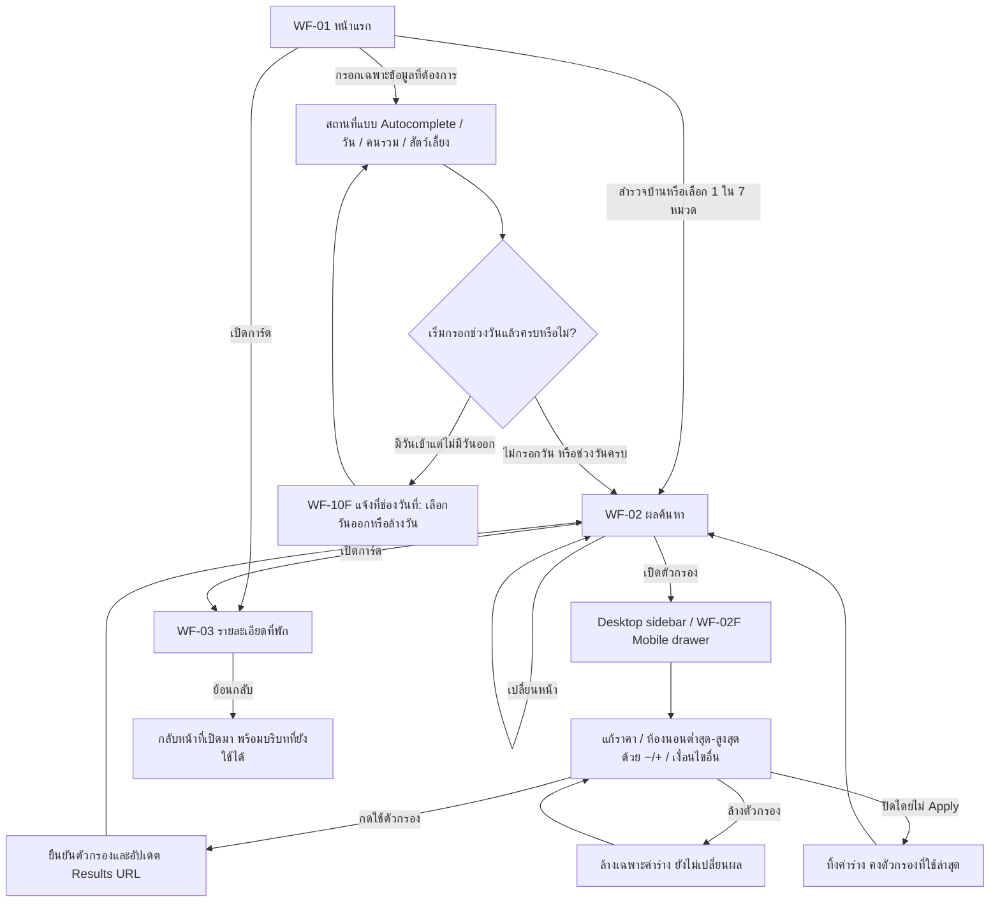
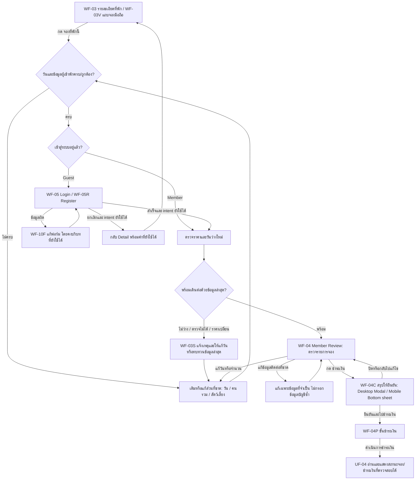
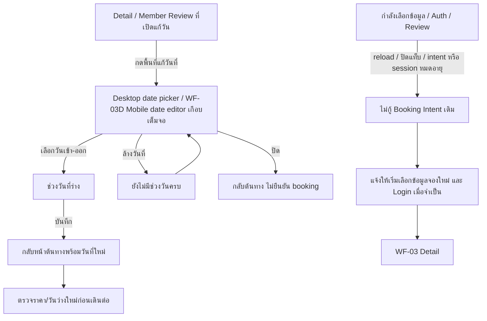
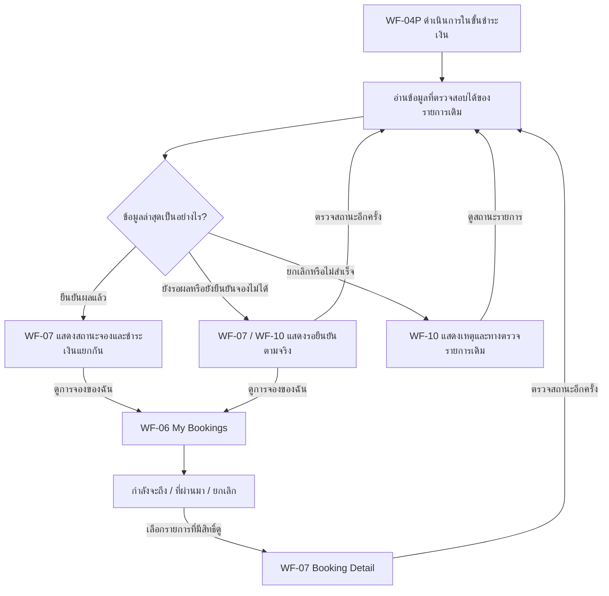
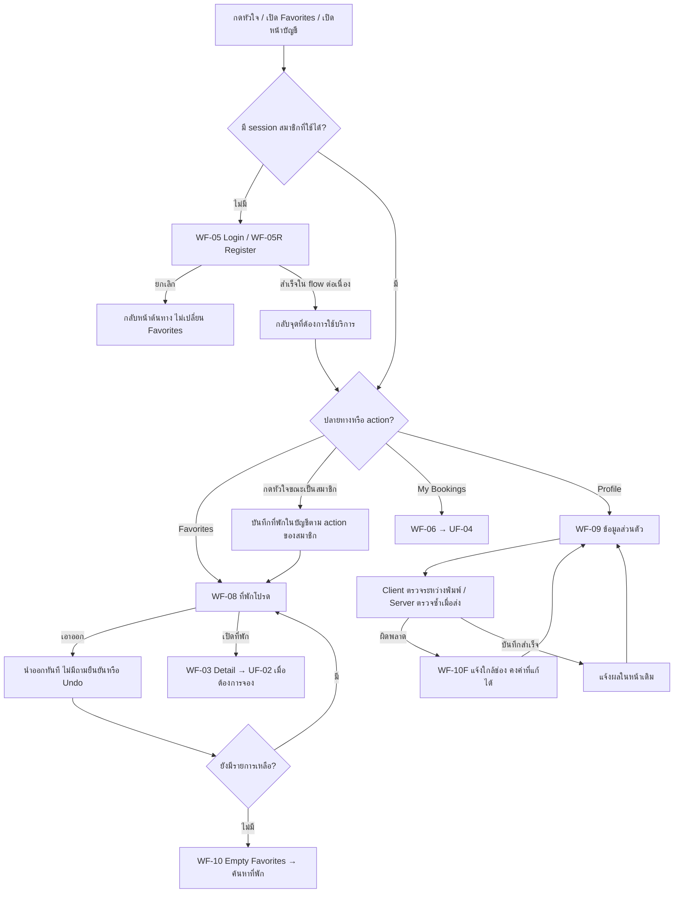

# UXD-002 review-5 — User flow

ชุดทบทวนมีครบ 8 กลุ่มทั้ง Desktop/Mobile แล้ว: [เปิดภาพคู่และจุดต่าง](flow-groups/desktop/README.md) · [สำเนาชั้นล่าสุด](flow-groups/desktop/editable-snapshot.json) กฎร่วมด้านล่างคงเดิม

วันที่ 3 พฤศจิกายน 2026 (Asia/Bangkok) · จัดเส้นทางจากข้อสรุปที่ยืนยันแล้ว · รอตรวจรับชุดออกแบบ

**ชุดทบทวนล่าสุดแบ่งตามงานผู้ใช้ครบ 8 กลุ่มบน canvas:** [FLOW-REVIEW F-01–F-08 พร้อมรูป](flow-groups/README.md) · [ภาพดัชนี](flow-groups/index.png) · [สำเนาชั้นล่าสุด](flow-groups/editable-snapshot.json) เริ่มที่ `FLOW-REVIEW — INDEX · 8 user tasks` ทางขวาของ canvas

| กลุ่มทบทวน | แผนผังอ้างอิงด้านล่าง |
|---|---|
| F-01 ค้นหา | UF-01 |
| F-02 เลือกข้อมูลเข้าพัก | UF-02 / UF-03 |
| F-03 Auth | UF-02 / UF-03 / UF-05 |
| F-04 Review / ยืนยัน / Payment | UF-02 / UF-03 |
| F-05 รับผลและสถานะ | UF-04 |
| F-06 Favorites | UF-05 |
| F-07 My Bookings | UF-04 / UF-05 |
| F-08 Profile | UF-05 |

กรอบ `USER-FLOW — START HERE` เป็นภาพรวมเดิม ส่วน `FLOW-DESKTOP` / `FLOW-MOBILE` มีหน้าจอจริงและลูกศรเชื่อม [ดูภาพรวม](user-flow-overview.png) และ [สำเนาก่อนเพิ่มกลุ่มทบทวน](editable-flow-snapshot.json) แผนผังด้านล่างเป็นเอกสารประกอบ canvas

เอกสารนี้เชื่อมหน้าจอ review-5 ตาม [owner confirmations](../review-decisions.md), [Interaction Specification](../interaction-specification.md) และ [UXD-001 review-2](../../uxd-001/journey-map.md) ไม่เปลี่ยน journey เดิมและไม่เพิ่ม scope ของ backend หรือ payment provider

อ่านภาพประกอบได้จาก [ดัชนี wireframe](README.md) และ [Component inventory](component-inventory.md) เส้นในแผนผังคือการนำทาง/เงื่อนไข UX ไม่ใช่ผลทดสอบปุ่มจริง

## UF-01 — สำรวจ ค้นหา และกรอง

- Home/Results/Detail เปิดได้โดยไม่ login ไม่ต้องเลือกวันหรือจำนวนคนก่อนเริ่มดูบ้าน
- วันที่และจำนวนคนใน Search เป็น optional; ถ้าเริ่มกรอกวันแล้วต้องตรวจความครบถ้วน
- Results เก็บ search/filter/page ใน URL; กลับจาก Detail รักษาบริบทนั้น ไม่ใช่การกู้ Booking Intent
- สถานที่ใช้ WF-02A สำหรับ suggestions/selected/no suggestions; กติกา free query ที่ไม่เลือก suggestion ยังเป็น D-03 ใน inventory ไม่กำหนดเพิ่มจากแผนผังนี้
- เส้นย้อนกลับจาก Detail หมายถึงกลับต้นทางจริง: ถ้าเปิดจาก Home/Favorites/direct link ให้ใช้ต้นทางนั้น ไม่บังคับกลับ Results เสมอ

## UF-02 — จองหลัก: Guest และ Member

กฎสำคัญ:

1. **Auth อยู่ก่อน Member Review/Checkout** ตาม F-01 ที่เจ้าของเลือกเมื่อ 3 พฤศจิกายน 2026; Member ที่มี session ใช้ได้ข้าม Auth
2. ข้อมูลจองต้องครบก่อนเปิด Auth ตาม UXD-001 J-02 เพื่อไม่ให้ login แล้วพบว่าต้องเริ่มกรอกใหม่
3. ใช้คนรวมหนึ่งค่าและ pets แยก ไม่แยกผู้ใหญ่/เด็ก/ทารก
4. หน้า Review จัดข้อมูลแบบ Airbnb แต่ไม่ใช้ตำแหน่ง Auth หรือบริการผ่อนชำระของ Airbnb
5. Q-11 เป็น dialog สรุปก่อน Payment step ของ paipak ไม่ใช่การยืนยันว่าจองหรือชำระเงินสำเร็จแล้ว
6. การแก้ข้อมูลที่มีผลต่อราคา/วันว่างต้องตรวจใหม่; จังหวะสร้าง booking record, hold, TTL, inventory lock และ provider semantics ยังอ้าง OPEN-003/006/007 ไม่กำหนดเพิ่มใน flow

Trace: I-08–I-12, I-23, I-24, I-27; UXR-02/05/06/10/11/12/20/23/24/25

## UF-03 — แก้วัน และคืนบริบทระหว่างทำรายการ

- Mobile แยกพื้นที่ราคา/แก้วันจากปุ่มหลัก “จองที่พักนี้”; date editor มี Close/Clear/Save
- วิธีจัดการค่าร่างที่ยังไม่ Save เมื่อปิด date editor ยังเป็น D-02 รอตรวจแบบ ไม่ถือว่าคำตอบเรื่อง Filter Drawer ใช้แทนได้
- กรณีหมดอายุ/โหลดใหม่ใช้กฎ Q-03 เดิม ไม่เรียกคืน draft จาก storage หรือข้ามแท็บ และไม่ส่งคำขอชำระเงินซ้ำอัตโนมัติ
- การล้าง draft ไม่ลบการจองที่สร้างจริง การชำระเงินจริง หรือ Favorites ของสมาชิก; อ่านรายการจริงได้หลังตรวจสิทธิ์

## UF-04 — ผลชำระเงินและการติดตามการจอง

- กลับจาก provider ไม่ใช่หลักฐานยืนยันธุรกรรมด้วยตัวมันเอง
- ไม่สรุปว่า payment สำเร็จแล้ว booking ต้องสำเร็จด้วย; แสดงสองสถานะตามข้อมูลจริง
- การลองชำระใหม่ต้องตรวจรายการเดิมก่อน ไม่สร้างคำขอเรียกเก็บซ้ำโดยอัตโนมัติ; ความสามารถ retry และ transition จริงยังรอ provider contract
- การมีแท็บ “ยกเลิก” ไม่ได้เพิ่ม flow ยกเลิกด้วยตนเองหรือคืนเงิน

Trace: I-12–I-14, I-17–I-18; UXR-05/12; OPEN-003/006/007

## UF-05 — Favorites และบัญชีสมาชิก

- ไม่มี Guest Favorites ชั่วคราวหรือ merge เมื่อ login; ก่อน Auth สำเร็จไม่ถือว่าหัวใจถูกบันทึกแล้ว
- หลัง Auth กลับจุดที่ต้องการใช้ Favorites; UXD-001/I-05 เสนอให้แสดงที่พักเดิมเพื่อกดยืนยันบันทึกอีกครั้ง ไม่กำหนดเป็น popup ยืนยันเพิ่ม และไม่ถือว่าได้บันทึกให้เงียบ ๆ ก่อน login
- การ remove เป็นคำตอบเจ้าของ Q-09; ทางบันทึกใหม่ยังใช้หัวใจตาม flow สมาชิก
- Profile ใช้ Modern Split ไม่มี SaaS dashboard, Collections, Comparison หรือ owner portal เพิ่ม

## กติกาตัวควบคุมที่ไม่เปลี่ยนหน้า

| Control | User action / outcome | State reference |
|---|---|---|
| Location autocomplete | พิมพ์ → suggestions → เลือกค่า; ไม่พบคำแนะนำให้แก้/ล้าง | WF-02A / I-25 |
| ห้องนอน | −/+ แยกต่ำสุด–สูงสุด → draft → Apply จึงเปลี่ยนผล | WF-02/WF-02F / I-06 |
| Carousel | ลูกศร/จุด/swipe เปลี่ยนภาพในใบเดิม ไม่เปิด Detail; ไม่ autoplay; สุดท้ายไม่วนและ next disabled | WF-10I / I-04/I-26 |
| รูปเดียว | ไม่แสดงลูกศรหรือ dots | WF-10I |
| ภาพโหลดไม่ได้ | icon + ข้อความ ไม่มี Retry; ยังเลื่อนไปภาพอื่นหรือเปิด Detail ผ่าน target แยกได้ | WF-10I |
| Form validation | Client ตรวจขณะพิมพ์ + Server ตรวจเมื่อส่ง; error มีข้อความและคงค่าที่ถูกต้อง | WF-10F / I-27 |
| Modal / drawer / editor | มีทางปิดและคืน focus จุดเปิด; modal focus อยู่ภายใน; รายละเอียดกลไกจริงทดสอบใน implementation | WF-01N/02F/03D/04C/05 |

## ความครอบคลุมกับ 10 templates

| Template | Flow |
|---|---|
| Home / Results / Property Detail | UF-01 และ UF-02 |
| Member Checkout / Authentication | UF-02 และ UF-03 |
| My Bookings / Booking Detail-Confirmation | UF-04 |
| Favorites / Member Profile | UF-05 |
| Contextual Empty-Loading-Error | ทุก flow ตาม context; WF-10/WF-10F/WF-10I |

## ขอบเขตการส่งมอบ

จัดรูปเส้นทางที่ตกลงไว้ลง canvas พร้อม PNG สำหรับทบทวนครบ 8 กลุ่มแล้ว ไม่ใช่การอนุมัติแบบ review-5 ไม่แก้ application code และไม่ยืนยันว่า navigation/Auth/payment ทำงานจริงแล้ว ข้อเสนอ D-01–D-06 และ OPEN-001–OPEN-007 ยังอ้าง [inventory](component-inventory.md) และเอกสารเดิม ไม่เติมข้อสรุปใหม่ในแผนผัง
